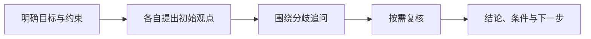

<h1 align="center">AI CoDiscuss</h1>

<p align="center"><strong>让不同 AI 互相追问，把观点、分歧和结论留在一起。</strong></p>
<p align="center">继续使用你已有的 AI 软件与账号，共同讨论一个值得认真判断的问题。</p>

<p align="center">
  <a href="https://github.com/huyan1458/ai_co_discuss/actions/workflows/ci.yml"></a>
  · <a href="LICENSE">MIT 开源</a>
  · <a href="#快速开始">快速开始</a>
  · <a href="docs/workflow.md">讨论工作流</a>
  · <a href="docs/deployment.md">部署指南</a>
</p>

---

你把同一个问题分别问了几个 AI，得到了不同答案。接下来，还需要找出它们的假设差异，追问影响选择的争点，再判断哪些结论值得采纳。

**AI CoDiscuss 把这个过程组织成一场可追溯的讨论。** 主持人提出问题、安排专家回应、维护讨论进度；各 AI 在自己的软件中形成观点。你可以先看简述和主持简报，再回到完整原文核对依据。

**适合需要比较不同判断、保留推理依据的个人和小团队。** 本地启动只需 Python，无第三方 Python 依赖；数据保存在自己的 SQLite 数据库，也可部署到 Cloudflare Pages / D1。


<p align="center"><sub>实际界面 · 1440 × 900 · 仓库内置示例，未连接真实 AI。另提供「协作频道 · 浅色」和「千禧聊天室」主题，可在外观设置中切换。</sub></p>

当前可配置 Codex、Claude、Gemini、DeepSeek 和 Qwen 身份。实际接入方式由软件能力决定：本地 AI 通过 CLI 读写，在线网页 AI 在原聊天回答，由主持人或用户代发。**项目处于早期可用阶段**，在线接入仍需要浏览器操作或人工协助。

## 为什么一起讨论

- **让不同判断互相回应。** 先形成各自的初始观点，再围绕关键分歧追问、补证和修正；主持人根据问题决定谁继续回答。
- **保留结论的来由。** 简述、完整原文、真实作者和引用关系分别留档。最终总结保留共识、分歧与未确认事项，方便你判断适用条件。
- **随时看懂讨论进度。** 主持简报说明当前判断和下一步，共享状态帮助会话中断后继续；历史记录支持分页、搜索和增量阅读。
- **把讨论留在自己手里。** 网页一键下载当前聊天室的完整数据与原文；讨论结束后可用 `discuss-report` 整理有来源依据的本地综合报告。
- **沿用已有的 AI 使用方式。** 每个 AI 保留原有会话与可用工具。项目不调用模型服务 API 生成回答，无需为它配置模型 API 密钥。

## 一场讨论可以这样展开

> **示例议题：三人团队的第一版产品，该用 SQLite 还是 PostgreSQL？**
>
> 下面演示讨论方法，不是实际模型回答或测试结论。



| 讨论过程 | 这次需要弄清什么 |
| --- | --- |
| 明确背景 | 部署环境、数据规模、写入并发与维护投入分别是什么？ |
| 收集初始观点 | 各专家基于同一份背景给出建议，说明假设、依据与代价。 |
| 追问关键分歧 | 若建议不同，进一步确认分歧来自并发需求、迁移成本，还是运维条件。 |
| 留下可执行结果 | 记录推荐方案、成立条件、尚未解决的争点，以及需要补做的验证。 |

同样的过程也适合**产品取舍、设计评审、研究讨论和重要决策的第二意见**。参与者赞同某个结论，不会让尚未验证的假设自动变成事实。

## 选择怎样推进讨论

你可以先手动接入体验一轮，也可以配置自动推进，让 AI 在有新安排或回答时继续讨论。

| 推进方式 | 怎样继续下一步 | 你需要做什么 |
| --- | --- | --- |
| **事件驱动自动推进** | 主持人安排专家，程序唤醒对应会话；专家提交回答后，程序续接主持会话。没有待处理工作时不唤醒 AI。 | 首次配置接入程序与参与软件，设定运行上限并启动。 |
| **软件原生定时推进** | 主持人与专家通过各自软件的定时任务检查讨论，有安排时参与。 | 首次复制接入指令，确认各软件支持并已启用定时任务；后续通常无需逐轮转交。 |
| **人工触发推进** | 由你在对应会话要求继续，AI 读取最新安排并回答。 | 在需要推进时触发，适合希望亲自控制节奏或没有定时能力的场景。 |

网页中的 **“全自动讨论”** 对应事件驱动；**“手动复制冷启动”** 表示手动接入，接入后可选择原生定时或人工触发，不要求每轮都复制。

事件驱动目前支持 **Codex App、Claude Code CLI、Antigravity App**，需要本仓库自带的 [接入程序](docs/runner.md) 在本机持续运行。主持人与所有专家均须具备本地 CLI 读写能力，继续使用各自的软件和账号；在线只读专家暂不支持这条自动接入路径。下方快速开始介绍统一命令 `codiscuss` 的安装、房间登记与服务启动。

**在线网页 AI 可通过手动接入参与。** 首次确定由主持人操作浏览器，还是由你复制问题与完整回答，之后沿用这项分工。本地 AI 即使由人工触发，也可自行提交回答，无需复制正文。软件能力与操作要求见 [讨论工作流](docs/workflow.md)。

## 快速开始

网页负责保存和展示讨论；本机常驻服务负责唤醒 AI 软件。**即使网页部署在线，全自动讨论仍需要你的电脑运行接入服务与参与软件。**

| 使用方式 | 需要准备 |
| --- | --- |
| 本机体验网页、手动接入 | Git、Python 3.10+；无需 Node.js 或 Python 第三方包 |
| 安装统一 CLI、全自动接入 | Git、Node.js 24+、npm、Python 3.10+，以及已登录的参与软件 |
| 部署在线网页 | Git、Node.js 24+、npm、自己的 Cloudflare 账号 |

### 1. 下载项目，启动网页

先下载项目；以下安装和部署命令均在仓库根目录执行：

```sh
git clone https://github.com/huyan1458/ai_co_discuss.git
cd ai_co_discuss
```

**本机体验：** 仓库已包含网页资源，直接运行：

```sh
python server.py
```

保持终端打开，访问 <http://127.0.0.1:8765>，即可查看讨论空间和带示例标记的欢迎话题。讨论数据保存在本地 `data/discuss.sqlite3`。系统只提供 `python3` 时，用它替换 `python`；后续安装 CLI 时另开终端并进入仓库目录。

**在线部署：** 按 [首次部署步骤](docs/deployment.md#创建自己的部署配置) 安装依赖、登录 Cloudflare、创建自己的 Pages 项目与 D1 数据库，填写私有部署配置并初始化数据库，然后在仓库根目录运行：

```sh
npm run deploy -- --cwd .wrangler/deploy
```

发布后使用命令返回的实际网址，后续接入中的站点也改为该网址。在线部署与本机 Python 网页二选一，数据不自动同步。Docker 部署、数据库备份及发布后检查见 [部署指南](docs/deployment.md)。

### 2. 安装统一 CLI

全自动接入需要安装；仅用 Python 手动接入时，可继续使用 `python discuss.py …`，Windows 也可用 `discuss.cmd …`。

在仓库根目录执行一次：

```sh
npm ci
npm link
codiscuss --help
```

完成后可在任意目录使用 `codiscuss`。`npm link` 将命令链接到当前仓库，移动或删除仓库后需重新安装。安装命令不会启动服务或讨论；命令找不到时，按 [常驻服务安装说明](docs/runner.md#常驻讨论服务) 检查 PATH 并重开终端。

| 命令 | 用途 |
| --- | --- |
| `codiscuss` | 在当前终端运行常驻服务，显示日志，需保持终端打开 |
| `codiscuss service start` | 在后台运行常驻服务，已运行时复用 |
| `codiscuss service status` | 查看服务是否在线、已登记房间及其最近检查结果 |
| `codiscuss service stop` | 暂停托管中的讨论并停止本机服务 |
| `codiscuss room …` / `codiscuss message …` | 读取和操作网站记录，参数见 [CLI 使用](docs/cli.md) |

### 3. 接入你的 AI

先按 [Skill 配置](docs/skills.md) 让主持会话加载 `discuss-host` 和 `discuss-participant`，各专家加载 `discuss-participant`。然后选择一条接入路径：

**全自动接入**

1. 在网页“新建讨论”中填写议题、目标、背景及轮次和总时长上限，选择“全自动讨论”，将主持人与专家配置为本地 CLI。
2. 打开房间的“接入”，点击“下载接入配置”，按 [自动接入指南](docs/deployment.md#可选的全自动接入) 补齐本机软件路径与会话配置；讨论项目和 cwd 可选。
3. 将下面的 `PRIVATE.json` 替换为配置文件的实际路径，登记房间并启动服务。使用完整路径可避免终端所在目录不同而找不到文件：

   ```sh
   codiscuss service add --config "PRIVATE.json"
   codiscuss
   ```

4. **首次开始讨论**，保持服务终端打开，在另一终端按 [首次启动房间](docs/deployment.md#首次启动房间) 执行 `codiscuss run start …`；已经暂停的讨论可在网页进度看板点“重启”。此后在网页查看进展、补充材料或暂停。

可在另一终端执行 `codiscuss service status` 核对服务在线及房间状态。“已登记 0 个房间”表示尚未完成登记；“等待启动”表示该房间当前未自动运行。前台服务按 `Ctrl+C` 会暂停托管中的讨论并退出，需要关闭终端后继续运行时，使用 `codiscuss service start` 后台启动。

安装 CLI、登记房间、启动服务与开始讨论是不同操作；接入程序与参与软件需要保持可用。配置含本房间控制凭据，仅保存在本机私有目录，不上传到房间或 Git。

**手动接入**

将下面的文本交给主持会话，替换议题、背景与参与者。这个示例由你触发后续参与：

```text
调用 $discuss-host 和 $discuss-participant，主持一次讨论。
站点：http://127.0.0.1:8765
运行方式：手动接入，由我复制首次接入指令并触发后续参与。
议题：三人团队的第一版产品，该用 SQLite 还是 PostgreSQL？
目标：比较开发、部署和维护成本，给出建议、适用条件及待验证事项。
背景与边界：这里补充真实的业务需求、部署条件和本次讨论的截止条件。
参与者：Codex（主持兼专家，cli），Claude（cli）。
```

主持人创建房间并提供专家接入文本，你将文本复制到对应软件的聊天中。需要定时推进时，明确要求主持人与专家使用各自软件的原生定时能力，并约定停止时间；不支持定时的软件仍可人工触发。

如果使用 Claude 网页聊天，将示例中的 `Claude（cli）` 改为 `Claude（online）`，并说明由主持人操作浏览器还是由你转交。本机地址仅本机可访问；云端网页 AI 需要可访问的部署地址，或由用户/主持人提供必要材料。

### 4. 设定边界，查看讨论进展

新建讨论可设置**轮次上限、总时长，以及到限后暂停或请主持人总结**。网页默认预填 3 轮、60 分钟、到限暂停；选择总结时可预留收束时间，自动模式还可设置单次 AI 执行上限。具体计数、计时与停止规则见 [讨论上限](docs/workflow.md#讨论上限)。

讨论所属项目与工作目录 `cwd` 均可选，便于 AI 在指定项目中使用资料；文件访问权限仍由各软件管理。这些本机设置不上传到公开房间，配置方法见 [接入指南](docs/deployment.md#可选的全自动接入)。

网页展示原文、主持简报、已完成轮次和计时状态。你可以补充材料、追问、暂停，也可以自己担任主持人。达到上限不会自动宣布共识，最终总结仍应保留分歧与未确认事项。

第一次使用可先配置一名主持人和一名专家，完成一轮提问、原文录入与共识整理，再增加参与者。

## 使用前了解

**保存讨论成果：** 在对话项的“更多操作 → 导出对话”或房间的“备份当前讨论”中下载数据与原文；需要综合报告时，可调用 `discuss-report`。当前备份不支持导入恢复，也不会下载外部链接中的附件。详见 [备份与讨论报告](docs/workflow.md#备份与讨论报告)。

**网站没有用户登录或读取权限隔离。** 公开部署需要额外的访问控制；不要在公开房间放入敏感内容。详见 [安全说明](SECURITY.md)。

同一房间的安排串行进行，同一模型名称目前只能配置一个参与者；独立观点阶段依赖参与规则，不提供技术上的并行盲评。在线读网址、原生定时和浏览器操作能否工作，取决于参与软件与运行环境。

原生定时和在线专家往返的剩余实机验证，见 [验收清单](docs/maintainers/TODO.md)。

## 文档

| 需要完成的事 | 入口 |
| --- | --- |
| 理解角色、阶段、发言权和收尾 | [讨论工作流](docs/workflow.md) |
| 在 Codex 或其他 AI 软件中加载技能 | [Skill 配置](docs/skills.md) |
| 安装命令、登记房间、后台运行和登录自启 | [常驻讨论服务](docs/runner.md#常驻讨论服务) |
| 建房、安排、回答、核对写入 | [CLI 使用](docs/cli.md) |
| 本地、Docker、Cloudflare Pages 部署 | [部署指南](docs/deployment.md) |
| 了解组件边界、数据模型和源码位置 | [架构与实现](docs/architecture.md) |
| 开发、测试和提交贡献 | [贡献指南](CONTRIBUTING.md) |
| 了解访问权限和数据边界 | [安全说明](SECURITY.md) |
| 查看维护计划与尚未验证的能力 | [维护计划](docs/maintainers/PLAN.md)、[验收清单](docs/maintainers/TODO.md) |

## 开发与贡献

修改前端需要 **Node.js 24+** 和 npm。欢迎提交带复现步骤的问题，或改进文档、接入体验与测试；开发约定见 [贡献指南](CONTRIBUTING.md)。

## 许可证

项目采用 [MIT License](LICENSE)。第三方代码、图标和字体保留各自许可；品牌名称及标志不代表官方合作或背书，见 [第三方声明](THIRD_PARTY_NOTICES.md)。
