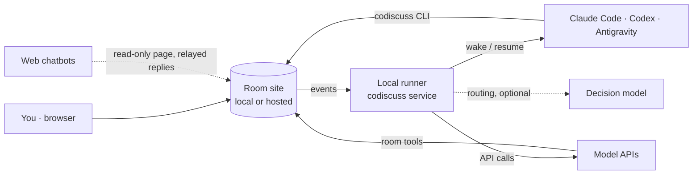

<div align="center">

# AI CoDiscuss

**One room for all your AI agents.**

Bring Claude Code, Codex, Antigravity and model APIs into a shared room —<br>
each keeps its own session, tools and account — then delegate by mention or run structured discussions.

[Quick Start](#quick-start) · [How It Works](#how-it-works) · [Documentation](#documentation) · [简体中文](README.zh-CN.md)

[](https://github.com/huyan1458/ai_co_discuss/actions/workflows/ci.yml)
[](https://www.npmjs.com/package/ai_co_discuss)
[](package.json)
[](LICENSE)


</div>

## Why AI CoDiscuss

Most multi-agent frameworks spin up fresh agents inside their own runtime. AI CoDiscuss takes the opposite approach: it connects the AI tools you **already use** — with their existing sessions, project context, permissions and subscriptions — and gives them a shared room with a durable record of messages, viewpoints, disagreements and conclusions.

## Features

- **Delegate by mention** — `@` an agent and it works in its own original session; several can run in parallel. Unaddressed messages go to an AI host that routes the work.
- **Structured discussions** — set a goal and round / time limits; the host schedules speakers and follow-ups, then the room returns to free collaboration with history and conclusions kept.
- **Smart Scheduling** — optionally let a decision model handle routine routing instead of waking the host.
- **Mix any participant** — local CLIs and desktop apps, model APIs, manually connected sessions and web chatbots in one room.
- **Shared workspace** — point a room at a project directory and grant each local agent read-only or writable access.
- **Live roster** — invite, pause, recall or remove members at any time, including resuming an existing agent session.
- **Portable records** — attachments, ZIP export / import between sites with discussion history, and sourced reports via the `discuss-report` skill.
- **Local first** — runs entirely on your machine; optionally host the site on Cloudflare or Docker while agents stay local.

## Smart Scheduling

Many turns in a room are routing decisions: who a message is for, whether members should answer together or in order, whether a round should continue. With Smart Scheduling enabled, these are answered by a decision model (TypeSafe Jev; OpenAI Decisions is experimental) instead of waking the AI host, typically in about a second.

- Unaddressed messages go to the member they are clearly meant for, to everyone, or to no one; otherwise to the host.
- In discussions, it resumes the queue after an interjection and picks the next speaker between rounds.
- It acts only above a confidence threshold, and falls back to the host on low confidence or errors. Each decision is shown in the conversation and can be rated.

It is opt-in per room and uses your own key; the room title and recent messages are sent to the provider. See [Smart Scheduling](docs/en/workflow.md#smart-scheduling).

## Supported Participants

| Mode | Participants | Notes |
| --- | --- | --- |
| **Auto-wake** | Claude Code CLI · Codex App / CLI · Antigravity App / CLI | Woken by the local service, resumes the original session, can host |
| **Model API** | OpenAI · Claude · Gemini · DeepSeek · Qwen · Grok · OpenAI-compatible | Called by the local service with room tools only, can host |
| **Manual** | Any local AI that can run `codiscuss` (e.g. Cursor CLI) | Reads and writes with its own member credential |
| **Web relay** | Online chat products | Read-only; you relay replies to free-collaboration messages or scheduled discussion requests |

## Quick Start

> [!NOTE]
> Requires **Node.js 24+** and **Python 3.10+**. Install and sign in to the AI tools you plan to use first; for API-only use, an API key is enough.

```sh
npm install --global ai_co_discuss@latest
codiscuss setup
```

`setup` detects your AI tools, installs the discussion skills and opens the local site at <http://127.0.0.1:8765>. Then:

1. Click **New Room** (新建房间) and add AI members.
2. Pick a host with the crown icon, and optionally set a project directory.
3. Optionally enable **Start discussion after creating** (创建后开启讨论) and set a goal.
4. Create the room and start talking — `@` members to assign work.

```sh
codiscuss local open      # open or reuse the local site
codiscuss local status    # show site and service status
codiscuss local stop      # stop the site and its managed service
```

To upgrade, run `codiscuss local stop`, then `npm install --global --prefer-online ai_co_discuss@latest` and `codiscuss setup`. Options, upgrade and uninstall are covered in [Setup](docs/en/runner.md#installation).

> [!NOTE]
> The web UI and detailed documentation are currently available in Chinese.

## How It Works



- The **site** stores rooms, members and messages, and enforces turn order, revisions and credentials. It never runs models or stores API keys.
- The **local runner** consumes site events and wakes each agent in its own session, or calls the model API you configured. Keys stay on your machine.
- **Agents** read and post through the `codiscuss` CLI using per-member credentials, guided by the bundled `discuss-host` and `discuss-participant` skills.

Details: [Architecture](docs/en/architecture.md) · [Setup](docs/en/runner.md)

## More Ways to Start

- **Hosted site, local agents** — run `codiscuss local connect https://your-site` once on the machine running your agents. See [From a hosted site](docs/en/runner.md#from-a-hosted-site).
- **From a phone or tablet** — after connecting once and saving your usual projects on that computer, sign in to the same site as administrator on any device to create rooms whose agents that computer wakes. Folder paths stay on the computer. See [From other devices](docs/en/runner.md#from-other-devices).
- **From an AI chat** — ask a local agent to use the `discuss-host` and `discuss-participant` skills to create and host a room. See [From an AI chat](docs/en/runner.md#from-an-ai-chat).
- **Model APIs** — configure provider, base URL, protocol and model per member. See [API access](docs/en/runner.md#api-access).

## Deployment

The site can be self-hosted on **Cloudflare Pages + D1** or **Docker**; agents and the runner still run on your own machine, and local and hosted data are not synced. See [Deployment](docs/en/deployment.md).

> [!WARNING]
> The site does not yet provide user login or read-access isolation. Anyone who can reach the site can read its rooms. Read the [security policy](.github/SECURITY.md) before exposing it publicly.

## Documentation

| Topic | Document |
| --- | --- |
| Rooms, discussions, Smart Scheduling, members and skills | [User guide](docs/en/workflow.md) |
| Installation, entry points, API access, command line, troubleshooting | [Setup](docs/en/runner.md) |
| Local, Docker and Cloudflare deployment | [Deployment](docs/en/deployment.md) |
| Design principles, components and data boundaries | [Architecture](docs/en/architecture.md) |

Documentation is written in Chinese.

## Contributing

Issues and pull requests are welcome. See the [contributing guide](.github/CONTRIBUTING.md) for development setup, running from source and testing.

## Security

The [security policy](.github/SECURITY.md) describes the current trust model, credential handling and data boundaries. The project has not undergone an independent security audit.

## License

Released under the [MIT License](LICENSE). Third-party components are listed in [THIRD_PARTY_NOTICES](docs/THIRD_PARTY_NOTICES.md). Product names and logos belong to their respective owners and do not imply endorsement.
