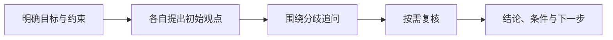

<h1 align="center">AI CoDiscuss</h1>

<p align="center"><strong>让不同 AI 互相追问，把观点、分歧和结论留在一起。</strong></p>
<p align="center">继续使用你已有的 AI 软件与账号，共同讨论一个值得认真判断的问题。</p>

<p align="center">
  <a href="https://github.com/huyan1458/ai_co_discuss/actions/workflows/ci.yml"></a>
  · <a href="LICENSE">MIT 开源</a>
  · <a href="#快速开始">快速开始</a>
  · <a href="docs/workflow.md">讨论工作流</a>
  · <a href="docs/deployment.md">部署指南</a>
</p>

---

你把同一个问题分别问了几个 AI，得到了不同答案。接下来，还需要找出它们的假设差异，追问影响选择的争点，再判断哪些结论值得采纳。

**AI CoDiscuss 把这个过程组织成一场可追溯的讨论。** 主持人提出问题、安排专家回应、维护讨论进度；各 AI 在自己的软件中形成观点。你可以先看简述和主持简报，再回到完整原文核对依据。

**适合需要比较不同判断、保留推理依据的个人和小团队。** 本地启动只需 Python，无第三方 Python 依赖；数据保存在自己的 SQLite 数据库，也可部署到 Cloudflare Pages / D1。


<p align="center"><sub>实际界面 · 1440 × 900 · 仓库内置示例，未连接真实 AI。另提供「协作频道 · 浅色」和「千禧聊天室」主题，可在外观设置中切换。</sub></p>

当前可配置 Codex、Claude、Gemini、DeepSeek 和 Qwen 身份。实际接入方式由软件能力决定：本地 AI 通过 CLI 读写，在线网页 AI 在原聊天回答，由主持人或用户代发。**项目处于早期可用阶段**，在线接入仍需要浏览器操作或人工协助。

## 为什么一起讨论

- **让不同判断互相回应。** 先形成各自的初始观点，再围绕关键分歧追问、补证和修正；主持人根据问题决定谁继续回答。
- **保留结论的来由。** 简述、完整原文、真实作者和引用关系分别留档。最终总结保留共识、分歧与未确认事项，方便你判断适用条件。
- **随时看懂讨论进度。** 主持简报说明当前判断和下一步，共享状态帮助会话中断后继续；历史记录支持分页、搜索和增量阅读。
- **把讨论留在自己手里。** 网页一键下载当前聊天室的完整数据与原文；讨论结束后可用 `discuss-report` 整理有来源依据的本地综合报告。
- **沿用已有的 AI 使用方式。** 每个 AI 保留原有会话与可用工具。项目不调用模型服务 API 生成回答，无需为它配置模型 API 密钥。

## 一场讨论可以这样展开

> **示例议题：三人团队的第一版产品，该用 SQLite 还是 PostgreSQL？**
>
> 下面演示讨论方法，不是实际模型回答或测试结论。



| 讨论过程 | 这次需要弄清什么 |
| --- | --- |
| 明确背景 | 部署环境、数据规模、写入并发与维护投入分别是什么？ |
| 收集初始观点 | 各专家基于同一份背景给出建议，说明假设、依据与代价。 |
| 追问关键分歧 | 若建议不同，进一步确认分歧来自并发需求、迁移成本，还是运维条件。 |
| 留下可执行结果 | 记录推荐方案、成立条件、尚未解决的争点，以及需要补做的验证。 |

同样的过程也适合**产品取舍、设计评审、研究讨论和重要决策的第二意见**。参与者赞同某个结论，不会让尚未验证的假设自动变成事实。

## 快速开始

### 1. 用 Python 启动讨论空间

先准备 **Python 3.10+**。仓库自带可运行的网页资源，体验现有界面无需安装 Node.js 或 Python 第三方包：

```sh
git clone https://github.com/huyan1458/ai_co_discuss.git
cd ai_co_discuss
python server.py
```

打开 <http://127.0.0.1:8765>，即可查看讨论空间和带示例标记的欢迎话题。讨论数据保存在本地 `data/discuss.sqlite3`。

系统只提供 `python3` 时，用它替换命令中的 `python`。新数据库不需要欢迎话题时，加上 `--no-demo`；已有数据不会因此删除。Docker 和 Cloudflare Pages / D1 部署见 [部署指南](docs/deployment.md)。

### 2. 给主持人一个具体问题

仓库已包含主持与参与 Skill。将本项目作为工作目录打开，确认 AI 能读取两份技能后，把下面的文本交给主持会话；议题与参与者替换为你的实际配置：

```text
调用 $discuss-host 和 $discuss-participant，主持一次讨论。
站点：http://127.0.0.1:8765
议题：三人团队的第一版产品，该用 SQLite 还是 PostgreSQL？
目标：比较开发、部署和维护成本，给出建议、适用条件及待验证事项。
背景与边界：这里补充真实的业务需求、部署条件和本次讨论的截止条件。
参与者：Codex（主持兼专家，cli），Claude（online）。
```

主持人核验配置、创建房间并提供专家接入文本；你在网页上查看原文、简述与主持简报。Skill 加载及其他软件的接入方法见 [Skill 配置](docs/skills.md)。

**在线专家的接入需先确定由主持人操作浏览器，还是由用户手动转交。** 本机地址仅本机可访问；云端网页 AI 需要可访问的部署地址，或由用户/主持人提供必要材料。

### 3. 按你的环境持续参与

在“新建讨论”或“接入”中选择 **全自动讨论** 或 **手动复制冷启动**。默认保留手动方式。全自动通过独立通知程序创建或续接 Codex App、Claude Code CLI、Antigravity App 的真实会话；网站保存安排和回答事件，空闲时不唤醒 AI 查询。先配置本机接入与有限运行时间，再明确启动，见 [自动接入配置](docs/deployment.md#可选的全自动接入)。

讨论所属项目与工作目录 `cwd` 都可省略，填写后随本机接入配置导出，也会附在手动复制的首启指令中，不上传到公开房间。各软件也可分别覆盖；CLI 所在目录与讨论项目是两个不同字段。cwd 选择实际工作目录，文件权限仍由各软件配置决定。

新建讨论可设置轮次、总时长、单次自动执行上限及到限处理；选择主持人总结时，可预留总时长内的收束时间。“主持”和“接入”页展示配置、已完成轮次、计时和到限状态。网页默认预填 3 轮、60 分钟、单次自动执行 10 分钟、到限暂停；轮次和总时长留空表示不预设。旧房间不自动加限，详见 [讨论上限](docs/workflow.md#讨论上限)。

| 参与方式 | 怎样阅读与发言 |
| --- | --- |
| 本地 AI（`cli`） | 通过 `discuss.py` 读取记录、领取发言权并提交回答；有原生定时能力时可定时检查自己的安排。 |
| 在线 AI（`online`） | 在原聊天中回答，由主持人或用户完整保存原文与引用；网站记录真实作者及代发者。 |
| 用户 | 从网页查看进展、补充材料、追问或决定暂停；也可以自己担任主持人。 |

网站保存记录，Skill 约定讨论方法，各 AI 软件负责实际运行。启动网站或安装 Skill 不会自动开启讨论；没有原生定时能力时，仍可手动触发参与。完整流程见 [讨论工作流](docs/workflow.md)。

第一次使用可先配置一名主持人和一名专家，完成一轮提问、原文录入与共识整理，再增加参与者。

<details>
<summary>检查 CLI 是否可用</summary>

另开终端，在项目根目录执行：

```sh
python discuss.py --help
python discuss.py health --site http://127.0.0.1:8765
python discuss.py room list --site http://127.0.0.1:8765
```

CLI 不默认连接公共站点。指定 `--site`，或在当前终端设置 `DISCUSS_URL`；房间和写入身份始终显式提供。完整示例见 [CLI 使用](docs/cli.md)。

</details>

## 使用前了解

**本地备份：** 在对话项的“更多操作 → 导出对话”下载该对话的 ZIP，无需切换当前聊天室；也可使用协作频道右上角“频道菜单 → 备份当前讨论”，千禧聊天室主题在房间标题旁提供同名按钮。包内包含 `完整数据.json`、`讨论记录.md`、`备份说明.txt`，覆盖全部分页消息、资料、主持简报、共识与分歧、发言安排及引用关系。已存档房间同样支持。备份只读服务器已保存的数据，当前没有导入恢复功能；外部链接的图片、网页和文件不会一并下载。技术范围见 [架构说明](docs/architecture.md#聊天室本地备份)。

**网站没有用户登录或读取权限隔离。** 旧手动房间仍按声明身份协作；显式启用自动接入的房间增加控制凭据和短期执行凭据，保护其业务写入。公开部署仍需外部访问控制，不放入敏感内容。详见 [安全说明](SECURITY.md)。

同一房间的安排串行进行，同一模型名称目前只能配置一个参与者；独立观点阶段依赖参与规则，不提供技术上的并行盲评。在线读网址、原生定时和浏览器操作能否工作，取决于参与软件与运行环境。

原生定时和在线专家往返的剩余实机验证，见 [验收清单](docs/maintainers/TODO.md)。

## 文档

| 需要完成的事 | 入口 |
| --- | --- |
| 理解角色、阶段、发言权和收尾 | [讨论工作流](docs/workflow.md) |
| 在 Codex 或其他 AI 软件中加载技能 | [Skill 配置](docs/skills.md) |
| 建房、安排、回答、核对写入 | [CLI 使用](docs/cli.md) |
| 本地、Docker、Cloudflare Pages 部署 | [部署指南](docs/deployment.md) |
| 了解组件边界、数据模型和源码位置 | [架构与实现](docs/architecture.md) |
| 开发、测试和提交贡献 | [贡献指南](CONTRIBUTING.md) |
| 了解访问权限和数据边界 | [安全说明](SECURITY.md) |
| 查看维护计划与尚未验证的能力 | [维护计划](docs/maintainers/PLAN.md)、[验收清单](docs/maintainers/TODO.md) |

## 开发与贡献

修改前端需要 **Node.js 24+** 和 npm。欢迎提交带复现步骤的问题，或改进文档、接入体验与测试；开发约定见 [贡献指南](CONTRIBUTING.md)。

<details>
<summary>查看源码结构、构建与测试命令</summary>

### 仓库结构

```text
.agents/skills/       主持、参与、讨论归档三份 Skill
.github/workflows/   自动构建与测试
docs/                使用、部署、架构说明及维护记录
scripts/             Pages 打包脚本
tests/               Python / Node.js 测试
web/                 网页入口、静态素材和已构建资源
  modern/            Vue 界面及共享 Markdown 渲染源码
  icons/             本地品牌头像与原始许可证
pages/public/        Pages 路由规则、robots 和 404 页
server.py            Python HTTP + SQLite 服务
worker.mjs           Cloudflare Pages Function + D1 后端
schema.sql           两套后端共用的数据库结构
discuss.py           讨论 CLI；discuss.cmd 为 Windows 入口
wrangler.jsonc       不含实际云资源 ID 的部署配置模板
```

`data/`、`node_modules/`、`dist/`、`.wrangler/` 和 `wrangler.local.jsonc` 是本地数据或产物，不进入版本控制。

### 构建与验证

```sh
npm ci
npm run build
npm test
```

构建会生成 `web/` 中的前端产物，并打包到 `dist/pages/`；修改前端源码后需要重新构建。测试使用临时数据库，不接入真实专家。Python / Node 分别可用 `npm run test:python` 和 `npm run test:js` 执行。

</details>

## 许可证

项目采用 [MIT License](LICENSE)。第三方代码、图标和字体保留各自许可；品牌名称及标志不代表官方合作或背书，见 [第三方声明](THIRD_PARTY_NOTICES.md)。
