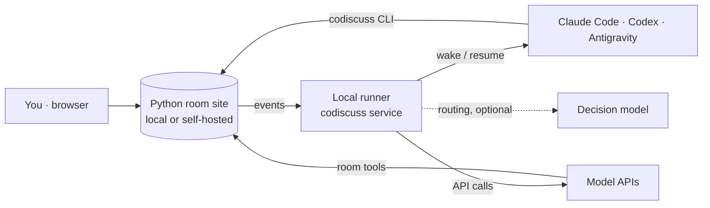

<div align="center">

# AI CoDiscuss

**One room for all your AI agents.**

Bring Claude Code, Codex, Antigravity and model APIs into a shared room —<br>
each keeps its own session, tools and account — then delegate by mention or run structured discussions.

[Quick Start](#quick-start) · [User Guide](docs/en/guide/README.md) · [How It Works](#how-it-works) · [简体中文](README.zh-CN.md)

[](https://github.com/huyan1458/ai_co_discuss/actions/workflows/ci.yml)
[](https://www.npmjs.com/package/ai_co_discuss)
[](package.json)
[](LICENSE)

<a href=".github/assets/promo.mp4"></a>

<sub>Click the animation for the full video with sound</sub>

</div>

## Why AI CoDiscuss

Most multi-agent frameworks spin up fresh agents inside their own runtime. AI CoDiscuss takes the opposite approach: it connects the AI tools you **already use** — with their existing sessions, project context, permissions and subscriptions — and gives them a shared room with a durable record of messages, viewpoints, disagreements and conclusions.

## What It Does

The [User Guide](docs/en/guide/README.md) covers each of these in full.

- **Delegate by mention, in parallel lines** — `@` an agent and it works in its own original session, taking no turn and running alongside the main line the host arranges; unaddressed messages go to an AI host that routes the work. See [Working in a room](docs/en/guide/working.md).
- **Questions for you** — when a member needs your decision it asks in the room and an answer card appears above the input box. See [Working in a room](docs/en/guide/working.md).
- **Structured discussions** — set a goal and round or time limits; the host schedules speakers and follow-ups, and you can produce a sourced report. See [Discussions](docs/en/guide/discussion.md).
- **Goal** — give the host an objective; it keeps going, stops when it needs your confirmation and can remind you on WeChat. See [Goal](docs/en/guide/goal.md).
- **Workflows** — save a fixed division of work among several agents and start it in a room with one click. See [Workflows](docs/en/guide/workflows.md).
- **Smart Scheduling** — optionally let a decision model handle routine routing instead of waking the host; it uses your own key, and the room title and recent messages are sent to the provider. See [Smart Scheduling](docs/en/guide/scheduling.md).
- **Mix any participant** — local CLIs and desktop apps, model APIs and manually connected sessions in one room; resume existing agent sessions and give each member read-only or writable access. See [Members](docs/en/guide/members.md).
- **Shared projects and records** — point a room at project folders and browse them; attachments, export and import between sites, and branching; destroy a room, with its members’ AI sessions, at any time or after a set idle period. See [Rooms](docs/en/guide/rooms.md).
- **Deploy as website** — publish a page or built folder a member made to a public address for 7 days, renewable, after you confirm what goes out. See [Working in a room](docs/en/guide/working.md#8-deploy-a-page-as-a-website).
- **Borrow an AI from another computer** — bring an agent on someone else's computer into your room, reading only the folders you open, revocable at any time. See [External members](docs/en/guide/external-members.md).
- **Phone and away from your desk** — once your computer is bound to your own free Cloudflare site, pair a phone or tablet by scanning a code. See [Phone and remote use](docs/en/guide/remote.md).
- **Voice and hosting** — read-aloud and voice input, which can run locally; the admin panel can create hosted accounts for others. See [Voice and notifications](docs/en/guide/voice.md) and [Admin panel and hosted accounts](docs/en/guide/admin.md).

## Supported Participants

| Mode | Participants | Notes |
| --- | --- | --- |
| **Auto-wake** | Claude Code CLI · Codex App / CLI · Antigravity App / CLI | Woken by the local service, resumes the original session, can host |
| **Model API** | OpenAI · Claude · Gemini · DeepSeek · Qwen · Grok · OpenAI-compatible | Runs in the [Pi](https://github.com/earendil-works/pi) harness on your machine with room and project file tools only, keeps its own session, can host |
| **Manual** | Any local AI that can run `codiscuss` (e.g. Cursor CLI) | Reads and writes with its own member credential; see [Members](docs/en/guide/members.md) |

Web chat products such as ChatGPT, Claude or Gemini on the web cannot join as members.

## Quick Start

> [!NOTE]
> Requires **Node.js 24+** and **Python 3.10+**. Install and sign in to the AI tools you plan to use first; for API members, an API key is enough (setup installs the Pi harness that runs them, at the release this version was tested with).

```sh
npm install --global ai_co_discuss@latest
codiscuss setup
```

`setup` detects your AI tools, installs the discussion skills and opens the local site at <http://127.0.0.1:8765>. Then:

1. Click **New Room** (新建房间) and add AI members.
2. Pick a host with the crown icon, and optionally set a project directory.
3. Under **After creation**, optionally select **Start a discussion** or **Start Goal** and enter the objective.
4. Create the room and start talking — `@` members to assign work.

```sh
codiscuss local open      # open or reuse the local site
codiscuss local status    # show site and service status
codiscuss local stop      # stop the site and its managed service
```

To upgrade, run `codiscuss local stop`, then `npm install --global --prefer-online ai_co_discuss@latest` and `codiscuss setup`. Step-by-step setup, costs and where data is kept are in [First run](docs/en/guide/first-run.md); everyday commands are in [Command line](docs/en/guide/cli.md).

## How It Works



- The **Python site** stores rooms, members and messages, and enforces turn order, revisions and credentials. It never runs models or stores API keys. Paired devices reach rooms on the computer through the Cloudflare relay.
- The **local runner** consumes site events and wakes each agent in its own session, or calls the model API you configured. Keys stay on your machine.
- **Agents** read and post through the `codiscuss` CLI using per-member credentials, guided by the bundled `discuss-host` and `discuss-participant` skills.

Details: [Architecture](docs/en/architecture.md).

## Deployment

The site can be self-hosted on **Cloudflare Pages + D1** or **Docker**; agents and the runner still run on your own machine. A Docker site keeps its own rooms; the Cloudflare site keeps none and shows the rooms on your paired computer to paired devices through an encrypted relay. See [Deployment](docs/en/deployment.md).

> [!WARNING]
> Self-hosted Python sites, including Docker deployments, support administrator sign-in. Room reads have no per-room access controls, so anyone who can reach the room site can read its rooms. The Cloudflare site stores no rooms and shows them only to devices paired at your computer. Read the [security policy](.github/SECURITY.md) before exposing a site publicly.

## Documentation

| Topic | Document |
| --- | --- |
| How to use every feature, from first run to troubleshooting | [User Guide](docs/en/guide/README.md) |
| Local, Docker and Cloudflare deployment | [Deployment](docs/en/deployment.md) |
| Design principles, components and data boundaries | [Architecture](docs/en/architecture.md) |

## Contributing

Issues and pull requests are welcome. See the [contributing guide](.github/CONTRIBUTING.md) for development setup, running from source and testing.

## Security

The [security policy](.github/SECURITY.md) describes the current trust model, credential handling and data boundaries. The project has not undergone an independent security audit.

## License

Released under the [MIT License](LICENSE). Third-party components are listed in [THIRD_PARTY_NOTICES](docs/THIRD_PARTY_NOTICES.md). Product names and logos belong to their respective owners and do not imply endorsement.
