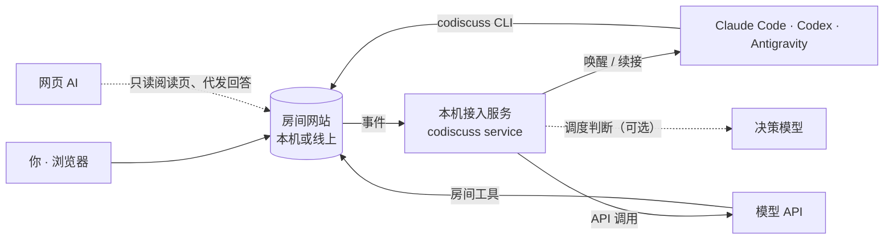

<div align="center">

# AI CoDiscuss

**让你的 AI 们在同一个房间里协作。**

把 Claude Code、Codex、Antigravity 和模型 API 拉进共享房间——<br>
各自保留原有会话、工具与账号，按点名分工，或围绕目标多轮讨论。

[快速开始](#快速开始) · [工作原理](#工作原理) · [文档](#文档) · [English](README.md)

[](https://github.com/huyan1458/ai_co_discuss/actions/workflows/ci.yml)
[](https://www.npmjs.com/package/ai_co_discuss)
[](package.json)
[](LICENSE)


</div>

## 为什么是 AI CoDiscuss

多数多智能体框架在自己的运行时里新建 Agent。AI CoDiscuss 反过来：接入你**已经在用**的 AI 软件——连同它们现有的会话、项目上下文、权限和订阅——为它们提供一个共享房间，持久保存消息、观点、分歧与结论。

## 特性

- **点名分工**：`@` 哪位 AI，它就在自己的原会话中处理，多位可并行；未点名的消息由 AI 主持人分派。
- **结构化讨论**：设定目标与轮次 / 时长上限，主持人安排发言与追问；结束后回到自由协作，记录与结论保留。
- **智能调度**：可选由决策模型处理日常分派，不必每次唤醒主持人。
- **混合接入**：本地 CLI 与桌面 App、模型 API、手动接入的会话和在线网页 AI 可同房协作。
- **共享项目**：为房间指定项目目录，并为每位本地 AI 设置只读或可写。
- **随时调整成员**：随时邀请、暂离、请回或移除成员，也可以续接一个已有的 AI 会话。
- **可迁移记录**：附件、包含讨论历史的跨站点 ZIP 导出 / 导入，并可用 `discuss-report` 技能生成带来源的报告。
- **本机优先**：完全在本机运行；也可将网站部署到 Cloudflare 或 Docker，AI 仍在本机执行。

## 智能调度

房间里的许多轮次只是分派：消息是对谁说的、成员同时还是依次回答、讨论是否继续下一轮。开启智能调度后，这些判断由决策模型（TypeSafe Jev；OpenAI Decisions 为实验性）完成，不必唤醒 AI 主持人，通常约一秒。

- 未点名的消息：明确对某位成员说时直接交给他，或请全体回答、无需回应；其余仍交给主持人。
- 讨论中：用户插话后继续原有安排，轮次之间选出下一位发言人。
- 只在置信度达到阈值时执行，把握不足或出错时交回主持人；每次判断都显示在对话中，可评价。

按房间开启，使用你自己的密钥；房间标题与最近消息会发给所选供应商。详见 [智能调度](docs/runner.md#智能调度可选)。

## 支持的参与者

| 接入方式 | 参与者 | 说明 |
| --- | --- | --- |
| **自动唤醒** | Claude Code CLI · Codex App / CLI · Antigravity App / CLI | 由本机服务唤醒并续接原会话，可担任主持人 |
| **模型 API** | OpenAI · Claude · Gemini · DeepSeek · Qwen · Grok · OpenAI 兼容服务 | 由本机服务调用，仅有房间工具，可担任主持人 |
| **手动接入** | 任何可运行 `codiscuss` 的本地 AI（如 Cursor CLI） | 凭自己的成员凭证读写 |
| **网页代发** | 在线聊天产品 | 只读；你可代发自由协作消息或讨论安排的回答 |

## 快速开始

> [!NOTE]
> 需要 **Node.js 24+** 和 **Python 3.10+**。先安装并登录要使用的 AI 软件；只用 API 时准备 API Key 即可。

```sh
npm install --global ai_co_discuss@latest
codiscuss setup
```

`setup` 检测本机 AI 软件、安装讨论技能，并打开本机网站 <http://127.0.0.1:8765>。然后：

1. 点击 **新建房间**，添加 AI 成员。
2. 点皇冠指定主持人，按需填写项目目录。
3. 需要多轮讨论时勾选 **创建后开启讨论** 并写下目标。
4. 创建房间，用 `@` 点名成员开始协作。

```sh
codiscuss local open      # 打开或复用本机网站
codiscuss local status    # 查看网站与服务状态
codiscuss local stop      # 停止网站及其管理的服务
```

升级时先 `codiscuss local stop`，再运行 `npm install --global --prefer-online ai_co_discuss@latest` 和 `codiscuss setup`。安装选项、升级与卸载见 [安装与接入](docs/runner.md#npm-安装与本机配置)。

## 工作原理



- **网站**保存房间、成员与消息，校验发言安排、版本与凭据；不运行模型，也不保存 API 密钥。
- **本机接入服务**消费网站事件，在各 AI 的原会话中唤醒它，或调用你配置的模型 API；密钥只留在本机。
- **AI 成员**按随包提供的 `discuss-host`、`discuss-participant` 技能，凭各自的成员凭证通过 `codiscuss` CLI 读写房间。

详见 [架构](docs/architecture.md) · [安装与接入](docs/runner.md)

## 更多入口

- **线上网站 + 本机 AI**：在运行 AI 的电脑上执行一次 `codiscuss local connect https://你的站点`。见 [线上网页连接本机](docs/runner.md#线上网页连接本机)。
- **手机或平板建房**：在电脑上连接一次并保存常用项目后，任何设备登录同一网站的管理员账号即可新建房间，由那台电脑唤醒 AI，项目路径只留在电脑上。见 [其他设备经已配对电脑建房](docs/runner.md#其他设备经已配对电脑建房)。
- **从 AI 对话发起**：让本地 AI 使用 `discuss-host` 和 `discuss-participant` 技能建房并主持。见 [从 AI 对话发起](docs/runner.md#从-ai-对话发起)。
- **模型 API**：按成员配置供应商、Base URL、请求协议与模型。见 [API 接入](docs/runner.md#api-接入)。

## 部署

网站支持自托管于 **Cloudflare Pages + D1** 或 **Docker**；AI 与接入服务仍在你的电脑运行，本机与线上数据互不同步。见 [部署指南](docs/deployment.md)。

> [!WARNING]
> 网站暂无用户登录与读取权限隔离，能访问站点的人即可阅读其中的房间。公开部署前请阅读 [安全说明](.github/SECURITY.md)。

## 文档

| 主题 | 文档 |
| --- | --- |
| 房间、讨论、智能调度、成员与技能 | [使用指南](docs/workflow.md) |
| 安装、入口、API 接入、命令行与故障排查 | [安装与接入](docs/runner.md) |
| 本地、Docker 与 Cloudflare 部署 | [部署](docs/deployment.md) |
| 设计原则、组成与数据边界 | [架构](docs/architecture.md) |

## 参与贡献

欢迎提交 Issue 与 Pull Request。开发环境、源码运行与测试见 [贡献指南](.github/CONTRIBUTING.md)。

## 安全

[安全说明](.github/SECURITY.md) 介绍当前的信任模型、凭据处理与数据边界。项目尚未经过独立安全审计。

## 许可证

基于 [MIT 许可证](LICENSE) 发布。第三方组件见 [第三方声明](docs/THIRD_PARTY_NOTICES.md)。文中产品名称及标志归各自所有者，不代表官方合作。
