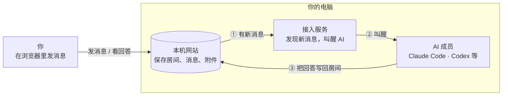
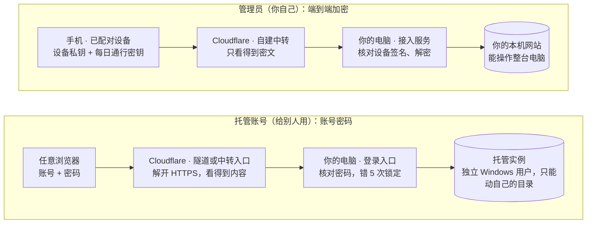

<div align="center">

# AI CoDiscuss

**让你的 AI 们在同一个房间里协作。**

把 Claude Code、Codex、Antigravity 和模型 API 拉进共享房间——<br>
各自保留原有会话、工具与账号，按点名分工，或围绕目标多轮讨论。

[快速开始](#快速开始) · [用户手册](docs/guide/README.md) · [工作原理](#工作原理) · [English](README.md)

[](https://github.com/huyan1458/ai_co_discuss/actions/workflows/ci.yml)
[](https://www.npmjs.com/package/ai_co_discuss)
[](package.json)
[](LICENSE)

<a href=".github/assets/promo.mp4"></a>

<sub>点击动画查看带配乐的完整视频</sub>

</div>

## 为什么是 AI CoDiscuss

多数多智能体框架在自己的运行时里新建 Agent。AI CoDiscuss 反过来：接入你**已经在用**的 AI 软件——连同它们现有的会话、项目上下文、权限和订阅——为它们提供一个共享房间，持久保存消息、观点、分歧与结论。

## 能做什么

每项的完整用法见[用户手册](docs/guide/README.md)。

- **点名分工，多线并行**：`@` 哪位 AI，它就在自己的原会话里处理，不占发言顺序，与主持人安排的主线并行；未点名的消息由 AI 主持人分派。见[在房间里干活](docs/guide/working.md)。
- **向你提问**：需要你拍板时，成员在房间里提问，输入框上方出现答题卡。见[在房间里干活](docs/guide/working.md)。
- **结构化讨论**：设定目标与轮次或时长上限，主持人安排发言与追问，可生成带来源的报告。见[讨论](docs/guide/discussion.md)。
- **Goal**：交给主持人一个目标，它持续推进，需要你确认时停下，可发微信提醒。见 [Goal](docs/guide/goal.md)。
- **工作流**：把固定的多人分工存成工作流，在房间里一键启用。见[工作流](docs/guide/workflows.md)。
- **全房间统计**：一句话看清 AI 替你干了多少活，列出需要你处理的问题并能点到具体运行；文件夹、模型、工作流与卡点放在明细里；本地导出讲工作量的分享图。见[统计](docs/guide/analytics.md)。
- **智能调度**：可选由决策模型处理日常分派，不必每次唤醒主持人；使用你自己的密钥，房间标题与最近消息会发给所选供应商。见[智能调度](docs/guide/scheduling.md)。
- **混合接入**：本地 CLI 与桌面 App、模型 API、手动接入的会话同房协作；可续接已有的 AI 会话，为每位成员设置只读或可写。见[成员](docs/guide/members.md)。
- **共享项目与记录**：为房间指定项目目录并在“文件”页浏览；附件、跨站点导出导入与分支；房间可随时或按设定期限销毁，连同成员的 AI 会话记录一起删除。见[房间目录与建房](docs/guide/rooms.md)。
- **部署为网站**：把成员做出的网页或构建好的目录发布到公网地址，确认上传内容后上线，有效 7 天、可续期。见[在房间里干活](docs/guide/working.md#8-把网页部署成网站)。
- **借用另一台电脑上的 AI**：把别人电脑上的 AI 请进你的房间，只读你开放的目录，随时撤销。见[跨电脑协作](docs/guide/external-members.md)。
- **手机与外出**：电脑绑定自建中转（可免费部署在 Cloudflare）后，手机或平板扫码配对即可远程使用；在国内访问时按网络情况选择中转地区，晚高峰较慢可开代理。见[手机与外出](docs/guide/remote.md)。
- **语音与托管**：朗读与语音输入，可在本机运行；管理面板可给别人开托管账号。见[语音与通知](docs/guide/voice.md)、[管理面板与托管账号](docs/guide/admin.md)。

## 支持的参与者

| 接入方式 | 参与者 | 说明 |
| --- | --- | --- |
| **自动唤醒** | Claude Code CLI · Codex App / CLI · Antigravity App / CLI | 由本机服务唤醒并续接原会话，可担任主持人 |
| **模型 API** | OpenAI · Claude · Gemini · DeepSeek · Qwen · Grok · OpenAI 兼容服务 | 在本机的 [Pi](https://github.com/earendil-works/pi) 中运行，只有房间与项目文件工具，有自己的会话，可担任主持人 |
| **手动接入** | 任何可运行 `codiscuss` 的本地 AI（如 Cursor CLI） | 凭自己的成员凭证读写，见[手动接入](docs/guide/members.md#手动接入) |

网页版 ChatGPT、Claude、Gemini 不能作为成员接入。

## 快速开始

> [!NOTE]
> 需要 **Node.js 24+** 和 **Python 3.10+**。先安装并登录要使用的 AI 软件；使用 API 成员时准备 API Key 即可（运行它们的 Pi 由安装器自动安装，版本为本版测试过的那一版）。

```sh
npm install --global ai_co_discuss@latest
codiscuss setup
```

`setup` 检测本机 AI 软件、安装讨论技能，并打开本机网站 <http://127.0.0.1:8765>。在 Windows 上，服务启动后任务栏会出现“共议”图标，点开即**管理面板**（服务启停与更新、AI 软件登录、自建中转绑定与中转地区；加 `--hosting` 运行 setup 还会开启托管账号），见[管理面板与托管账号](docs/guide/admin.md)；macOS 与 Linux 暂无管理面板。然后：

1. 点击 **新建房间**，添加 AI 成员。
2. 点皇冠指定主持人，按需填写项目目录。
3. 需要多轮讨论或持续推进目标时，在“创建后”选择“开启讨论”或“开启 Goal”，并填写目标。
4. 创建房间，用 `@` 点名成员开始协作。

```sh
codiscuss local open      # 打开或复用本机网站
codiscuss local status    # 查看网站与服务状态
codiscuss local stop      # 停止网站及其管理的服务
```

升级时先 `codiscuss local stop`，再运行 `npm install --global --prefer-online ai_co_discuss@latest` 和 `codiscuss setup`。逐步说明、费用与数据位置见[第一次使用](docs/guide/first-run.md)，常用命令见[命令行](docs/guide/cli.md)。

## 工作原理



- **本机网站**：房间、成员、消息和附件都存在这里，在电脑上用浏览器打开 <http://127.0.0.1:8765>。它负责保存和校验（谁该发言、版本是否最新、凭据是否有效），不运行模型，也不保存 API 密钥。
- **接入服务**：房间里有新消息要 AI 处理时，它在 Claude Code、Codex 等软件的原会话里叫醒对应的 AI，或调用你配置的模型 API；手机经自建中转发来的请求，也由它转交给本机网站。密钥只留在本机。
- **AI 成员**按随包技能 `discuss-host`、`discuss-participant`，凭各自的成员凭证通过 `codiscuss` CLI 读写房间。

在外面用手机访问，见下面的[部署](#部署)。

详见 [架构](docs/architecture.md)。

## 部署

本机网站随 `codiscuss setup` 安装，房间只存在你的电脑上。需要在外面访问时，按场景选一种方式：

| 方式 | 适合 | 房间存在哪 | 前提 |
|---|---|---|---|
| **自建中转**（Cloudflare Pages + D1 + Durable Object） | 自己用手机、平板远程访问电脑 | 你的电脑 | 免费 Cloudflare 账号；设备在电脑前扫码配对 |
| **Cloudflare 隧道** | 托管账号的使用者从外网登录 | 你的电脑（托管实例） | 托管在 Cloudflare 上的域名；Windows |
| **Docker / 自托管 Python 站点** | 想把房间放在服务器上 | 服务器 | 一台服务器；自己维护 HTTPS 与访问控制 |

两类使用者的安全设计不同：



- **管理员**：管理员能操作整台电脑，所以用最严格的一套；设备授权 30 天到期，可随时在电脑上撤销。
- **托管账号**：登录页对外公开，输错 5 次锁定 10 分钟；托管客户的房间存在你的电脑上，**你作为运营者能看到**。

AI 与接入服务始终在你的电脑运行。见 [部署指南](docs/deployment.md)、[手机与外出](docs/guide/remote.md)、[管理面板与托管账号](docs/guide/admin.md)。

> [!WARNING]
> 自托管 Python 站点（含 Docker）支持管理员登录。房间没有逐房间的读取权限隔离，能访问房间站点的人即可阅读其中的房间。Cloudflare 站点不保存房间，只向在电脑前配对过的设备显示；已配对设备会在浏览器里缓存看过的附件（未加密），解除配对时清除。公开部署前请阅读 [安全说明](.github/SECURITY.md)。

## 文档

| 主题 | 文档 |
| --- | --- |
| 全部功能的用法，从第一次使用到常见问题 | [用户手册](docs/guide/README.md) |
| 本地、Docker 与 Cloudflare 部署 | [部署](docs/deployment.md) |
| 设计原则、组成与数据边界 | [架构](docs/architecture.md) |

## 参与贡献

欢迎提交 Issue 与 Pull Request。开发环境、源码运行与测试见 [贡献指南](.github/CONTRIBUTING.md)。

## 安全

本机服务数据达到 8 GiB 时提醒，超过 10 GiB 时停止派发新任务，语音模型单独统计。草稿限额为每房间 1 GiB、全机 3 GiB。运行期间按周期检查，持续写入可能在被停止前超过限额。[管理本机存储](docs/guide/admin.md)

[安全说明](.github/SECURITY.md) 介绍当前的信任模型、凭据处理与数据边界。项目尚未经过独立安全审计。

## 许可证

基于 [MIT 许可证](LICENSE) 发布。第三方组件见 [第三方声明](docs/THIRD_PARTY_NOTICES.md)。文中产品名称及标志归各自所有者，不代表官方合作。
