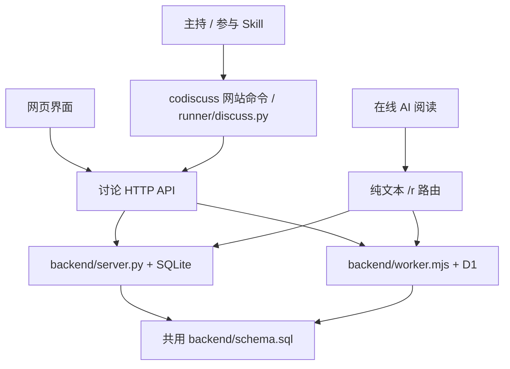

# 架构与实现

## 设计边界

AI CoDiscuss 分开保存讨论事实、执行单次读写和组织讨论决策。这样每个 AI 保留自身软件的会话、工具和账号能力，网站只承担共享上下文与协作约束。直接调用模型服务 API 来代替这些软件参与不属于本项目方向。

Python 与 Cloudflare 是两种部署实现，运行时选其一，不是请求依次经过两层服务。全自动模式下，本机运行的 `runner/` 接入程序增量读取业务事件并触发真实软件，空查询不调用模型。手动模式继续使用原生定时或人工触发。

## 模块与接口职责

| 位置 | 输入 | 输出 / 副作用 |
| --- | --- | --- |
| `backend/server.py` | HTTP 请求、SQLite 路径、`backend/schema.sql` | JSON API、纯文本页面、静态资源；事务读写本地数据库；根目录 `server.py` 调用其启动函数 |
| `backend/worker.mjs` | Pages Request、D1 `DB` binding | 与 Python 相同的业务响应；静态请求交由 Pages assets |
| `runner/codiscuss.mjs` | 统一 `codiscuss` 命令与原样参数 | 无子命令时启动本机服务，`service` 管理进程；网站命令转交 Python 客户端，保留 stdin、相对路径与退出码 |
| `runner/discussion_launch.mjs` | 本机默认软件配置、单场启动配置、对话 / 网页入口 | 校验后建房、保存私有配置、启用运行并登记接入服务；对话入口将首个主持任务交回当前会话；暂停后可凭原控制凭据和版本修正本场软件路径，不改变会话绑定或自动重启 |
| `runner/discussion_setup.mjs` / `discussion_skills.mjs` | npm 包、已有 Python / CLI、选定软件 | 持久安装统一命令，合并本机软件配置，复制完整技能并保留本地修改；不创建讨论 |
| `runner/discussion_local.mjs` | 用户服务目录、Python 和端口配置 | 后台网站及包外 SQLite，复用讨论服务、检查就绪、仅停止拥有的进程 |
| `runner/discuss.py` | 命令、站点、房间、声明身份、UTF-8 文件 | 网站客户端实现；单次 HTTP 请求、稳定 JSON / 文本、退出码，帮助和预览可离线，可直接用 Python 执行 |
| `web/app.js` | 页面事件和 API 返回状态 | 共享讨论控制器、读写操作、主题与界面同步 |
| `web/index.html` / `web/style.css` | 控制器状态 | 经典主题界面 |
| `frontend/` | 同一控制器与 API | Vue / Nuxt UI 协作频道、资料/讨论/主持与接入、对话框 |
| `frontend/markdown.mjs` | Markdown 原文 | 三个主题共用的安全 HTML 与公式渲染；原始 HTML 关闭 |
| `runner/` | 私有房间配置、网站事件 | 接入 Codex App / CLI、Claude Code CLI、Antigravity App / CLI 的真实会话，续租与有限重试；`discussion_service.mjs` 常驻托管多个已登记房间；不生成回答，详见 [自动接入程序](runner.md) |
| `scripts/build_pages.mjs` | 后端源码、已构建 `web/`、Pages 静态文件 | 清理固定输出并生成 `dist/pages/`；不部署 |

两套后端、Python 运行协议与共用 schema 位于 `backend/`；前端源码及 Vite 配置在 `frontend/`，静态运行文件在 `web/`，测试和构建脚本分别在 `tests/`、`scripts/`。`deploy/` 保存 Docker 文件，`.github/` 保存 CI、贡献指南和安全说明，第三方声明位于 `docs/`。根目录保留用户启动入口和工具约定的配置文件；`python server.py` 仍以项目根目录定位网页与默认数据库，不受终端工作目录影响。

Python 服务独占监听端口：Windows 使用 `SO_EXCLUSIVEADDRUSE`，关闭地址复用；其他平台保留常规重启所需的地址复用，但不允许复用正在监听的端口。第二个实例在启动时失败，避免请求被分配到另一个讨论数据库。

`--local-launch` 是仅限回环监听的可选本机控制接口，公开部署默认关闭。本机网页使用同源请求；`codiscuss local connect SITE` 为指定 HTTPS 来源生成连接凭据后，线上浏览器也可直接调用该电脑的接口。连接信息保存在浏览器本地存储，本机 `site-connections.json` 仅存来源与凭据哈希；不扫描公开房间或自动接管未明确启动的讨论。来源和凭据验证通过后，接口把 `site` 固定为该来源，再经固定 Node 入口调用共享启动器；路径与连接凭据不经过线上服务器。启动器复用两套后端已有建房、运行、事件协议，Cloudflare 不提供进程启动接口，无需新增 D1 表。网页的启动配置由 `frontend/LaunchSettings.vue` 与共享控制器维护，两个现代主题和经典主题使用同一启动请求。

网页在请求前按原提交号或房间保存完整待办；展示快照仅含标题、房间编号与错误，不包含待办中的凭据或私有配置。刷新后的恢复必须由用户显式触发，重放原输入进入启动器已有日志；每次发送的独立编号防止跨标签迟到失败覆盖较新的待办状态。本机桥接保留启动器的部分失败阶段，只有控制权验证后才返回原房间编号；浏览器请求必须显式携带控制凭据，不回退到磁盘中的凭据代为认领。网站业务协议和 Cloudflare 后端不受此本机恢复接口变更影响。

## 数据模型

两套讨论后端使用同一 `backend/schema.sql`：

| 表 | 内容 |
| --- | --- |
| `rooms` | 房间基本信息和共享状态 |
| `room_directory`、`topic_folders`、`room_folder_assignments`、`directory_settings` | 话题目录、归档、分组与未归类的位置 |
| `room_creations` | 创建提交编号和初始请求，用于精确核对重试 |
| `room_briefs` | 主持简报、覆盖消息截止和更新时间 |
| `room_user_requests` | 独立保存用户请求原文，与补充背景分开 |
| `topic_settings` | 主持人、阶段、焦点和参与方式 |
| `discussion_limits` | 轮次、总时长、单次执行上限、到限方式、收束预留及实际计时状态 |
| `discussion_pauses` | 每个房间当前暂停起点与累计暂停秒数；离开进行中阶段时由触发器记起点，恢复时累加，用时与总时长截止均扣除 |
| `messages` | 原始消息、作者、来源、回复与提交编号 |
| `message_summaries` | 回答简述及其实际撰写者 |
| `message_details` | 消息职责、代发操作者、关联安排 |
| `discussion_turns` | 问题、专家、通知状态、回答与取消 |
| `room_floor` | 发言权持有人、下一位和版本 |
| `turn_relay` | 整轮接力暂停标记：`held_since` 为首个待主持人处理的用户操作，非 0 时回答交回主持人而不接力 |
| `discussion_runtime` | 显式模式、运行 ID、代次、截止时间、版本及控制凭据哈希 |
| `discussion_events` | 持久业务原因和对应的一次执行、身份、状态、真实会话及租约；事件 ID 兼执行 ID |
| `event_timings` | 执行的交付与结束时间（触发器在状态变化时写入），供进度看板计算阶段耗时 |
| `runtime_assertions` | D1 批次内授权断言；检查失败则整批回滚，成功后删除临时行 |

数据库唯一约束阻止重复提交和多个未完成安排；触发器检查阶段、安排关联及持有人，并在保存消息/安排时完成交接。两套后端也执行相应业务校验；修改协议需同步服务、schema、CLI 和相关测试。

旧库初始化会补齐缺失表和记录，保留已有消息与安排。迁移不能重置当前 `room_floor`；新增迁移需要验证旧库和重复执行行为。Python 服务启动会应用 schema；远端 D1 更新由部署者明确执行。

频道资料将“用户原文”与“背景”作为同级章节，新建和编辑资料分别填写；两套后端、CLI 的 `room brief`、纯文本资料页与可读备份均提供独立原文。`user_request` 限 4000 字并保留首尾空白，由增量表 `room_user_requests` 保存；D1 升级须先应用 schema。旧房间没有独立记录时，仅对背景开头“用户原文：”及后续独占一行的“项目背景与入口：”或“背景：”明确分隔进行兼容读取，读取不改原始数据；下次保存资料时分开落库。未明确分隔的旧背景保持原样。

## 读写协议

常用 API 为 `/api/health`、`/api/rooms` 和 `/api/rooms/ROOM_ID` 下的 messages、state、turns、floor 等接口。具体方法、字段与当前限制通过 `codiscuss schema` 和 `codiscuss room protocol ROOM` 获取；原 Python 入口继续兼容，避免维护第二套过期请求样例。

| 纯文本入口 | 内容 |
| --- | --- |
| `/r/ROOM_ID` | 目标、阶段、主持人、当前安排和按需阅读链接 |
| `/r/ROOM_ID/brief` | 背景、边界、参与配置 |
| `/r/ROOM_ID/state` | 主持简报、共享状态及已读截止 |
| `/r/ROOM_ID/messages` | 分页原文，每页 20 条 |
| `/r/ROOM_ID/messages/ID` | 精确消息、作者和来源 |
| `/r/ROOM_ID/search` | 关键词、作者或 @ 对象检索 |
| `/r/ROOM_ID/turns`、`/turns/ID` | 安排历史或具体问题与回答入口 |
| `/r/ROOM_ID/protocol` | 当前参与与写入协议 |

`?mode=cli` 为可写客户端提供对应引导，`?participant=NAME` 提供该参与者的检索入口。默认概要不夹带全部背景、主持总结或历史，支持独立阶段的按需阅读；这不是服务端权限隔离。

GET / HEAD 不发布消息；旧 `/r/ROOM_ID/publish` 返回 410。新增内容使用 POST，消息追加保存。创建操作用 `submission_id` 去重，修改资料与状态前先读取现状；不要将 HTTP 超时解释为服务拒绝。

### 目录写入

`POST /api/folders/FOLDER_ID/move` 接收 `before_id`（null 表示整个列表末尾），两处编号均可使用保留值 `__uncategorized__` 表示内部排序用的虚拟分组。两套后端在同一事务更新 `topic_folders.position` 和 `directory_settings.uncategorized_position`，返回真实 `folders` 与未归类频道区域的零基位置；目录读取也返回这两个字段。位置为 null 时该区域保持在末尾，新建文件夹排在它前面；设置为具体位置后，新建文件夹追加到真实文件夹末尾，不挤动该区域。旧库应用 schema 后默认保持原顺序，重复初始化不覆盖已保存位置；D1 部署前须应用 schema。虚拟分组不写入 `topic_folders`，未归类对话的 `folder_id` 仍为 null。

`POST /api/folders/FOLDER_ID/rename` 接收 1–40 字符的 `name`，保留文件夹编号、顺序与对话归属。建房请求可带 `folder_id`，省略或 null 表示未归类；两套后端均将建房与归类放在同一事务，并将指定文件夹纳入创建请求的幂等校验。重试返回已创建的对话，不再次变更后来调整的归属；不存在的文件夹会使创建失败，不留下孤立对话。

`POST /api/folders/FOLDER_ID/delete` 仅移除真实文件夹，使用既有 `ON DELETE SET NULL` 外键将普通和存档频道的归属清空，并在同一事务中调整未归类的位置，其他分组保持相对顺序。它不删除频道或消息，不改变讨论阶段与运行状态；不存在的文件夹及虚拟分组返回 404。复用现有表和外键，无需 schema 迁移。

## 聊天室本地备份

`GET /api/rooms/ROOM_ID/backup` 返回 `format=ai-codiscuss-room-backup`、`version=1`、`exported_at` 和 `tables`。`tables` 包含讨论资料相关的 14 张表中属于指定房间的全部原始行，保留编号、时间、正文、创建请求、摘要与摘要作者、代发者、引用、安排和发言权版本；只带所属文件夹自身，不带同文件夹的其他房间。它不接受分页或搜索过滤，不修改房间状态；空房间可导出，不存在的房间返回 404。

Python 在一个只读事务快照中查询；D1 使用同一个 batch 事务读取，避免导出中途新增消息导致正文与关联元数据不一致。网站目前没有文件附件存储；外部链接只保留地址，未保存草稿与其他部署配置不在备份内。

`frontend/backup.mjs` 接收完整快照，通过 fflate 在浏览器内生成 ZIP：`完整数据.json` 保存可核对的原始字段，`讨论记录.md` 提供离线原文及消息/安排锚点，`备份说明.txt` 记录范围。三个主题通过同一控制器触发，下载中切换房间不会改变本次备份对象。请求或打包失败不生成部分成功包，用户可再次操作重试。备份需要将完整房间载入内存，当前未实现流式导出或导入恢复；很大的房间受浏览器及部署资源限制。

## 前端与素材

### 源码与构建

`frontend/` 保存 Vue、Markdown 和备份源码；`web/` 保存共享控制器、经典主题、图标和构建产物。生成产物随仓库提供，保证仅安装 Python 的用户也能运行网页；不在生成文件中手工修改功能。

| 源码 | 职责 |
| --- | --- |
| `main.js`、`App.vue`、`ChannelWorkspace.vue` | 协作频道入口、主题与整体布局 |
| `ChannelDirectory.vue` | 频道、文件夹和存档管理 |
| `ChannelDiscussion.vue` | 议题卡、消息流、原文导航和输入区 |
| `TopicPanel.vue`、`WorkspaceDialogs.vue` | 话题资料、主持操作、接入步骤及编辑对话框 |
| `CreateDiscussion.vue`、`LaunchSettings.vue` | 新建讨论表单（话题与用户原文、参与者与 AI 主持、上限预设）及本机启动配置 |
| `ProgressBoard.vue`、`ProgressPanel.vue` | 共享进度看板及抽屉容器 |
| `use-discussion.js` | 将 `web/app.js` 的共享控制器状态接入 Vue |
| `theme.css`、`channel.css` | 组件主题、深浅配色与响应式布局 |
| `markdown.mjs`、`markdown.css`、`backup.mjs` | 三个主题共用的内容渲染与本地导出 |

`frontend/vite.config.mjs` 构建三个入口：Markdown IIFE、备份 IIFE 和 Vue ES 模块，由根目录 npm 脚本显式指定配置。输出为 `web/markdown.js`、`web/markdown.css`、`web/backup.js`、`web/modern.js`、`web/modern.css`。字体随 CSS 打包，图标来自本地 `web/icons/` 与构建时 Iconify 数据，无需运行时请求图标 CDN。

`scripts/build_pages.mjs` 将静态运行文件、`backend/worker.mjs` 和许可证汇集到 `dist/pages/`；`pages/public/` 补充路由、robots 和 404。它只清理固定输出目录，指定源码快照时全部文件取自同一快照，并兼容整理前的文件布局，不混入工作区其他版本。第三方声明在发布目录中仍为 `THIRD_PARTY_NOTICES.md`；前端源码和隐藏文件不发布到 Pages。

### 主题与交互边界

界面提供默认深色「协作频道」、浅色协作频道和经典「千禧聊天室」。深浅频道共用组件，浅色覆盖同时作用于正文、菜单和弹窗；只有深色频道启用根节点的 `dark` 类。频道界面的外观设置集中在左下角，窄屏可从频道导航抽屉进入。主题保存在浏览器，切换保留房间、筛选与未发送草稿。

深浅频道采用统一的低饱和蓝灰色系，由 `channel.css` 的背景、表面、强调色与分级阴影变量维护。左右侧栏共用底色，三栏标题与主持简报共用顶部表面色；正文底色、卡片与控件用明度差区分，避免各区域使用不同冷暖的灰色。深色卡片保留顶部亮边、底部暗边和局部渐变；浅色使用白色卡片、蓝灰细描边与柔和投影。交互状态共用蓝色强调色，参与者和运行状态保留各自的语义颜色。

左右侧栏仅用朝向正文的柔和阴影分界，避免竖向描边与内侧高光线重复叠加。分栏拖柄覆盖接缝，层级高于主持简报、低于浮动预览，不占用布局宽度，仅在悬停、聚焦或拖动时显色。新建入口与导航选中项具有独立边界，右栏状态为轻浮起面板，焦点、参与者及耗时以留白和分隔线分组。消息、共识与主持面板使用较轻阴影，按钮使用短投影，菜单和抽屉使用浮层投影，搜索和表单使用内阴影；按下和禁用时降低或移除投影。输入区聚焦保留面板阴影并叠加焦点边界。材质调整保留三栏结构、阅读宽度和经典主题。

接入页按选择的模式展示操作：全自动显示下载配置、登记房间和启动服务，手动显示参与指令；项目、工作目录、讨论上限和原始错误按需展开。页面复用共享控制器，不推断本机服务在线状态，选择模式或下载配置也不会启动讨论。

消息区显示议题、原文和主持简报；简报收起时以局限在消息列内的底部渐隐阴影区分正文，不向侧栏溢出；展开后由浮层承接投影，避免叠加阴影或推动消息与输入区。已存档频道在独立弹窗管理，不改变当前频道和草稿。存档频道仍可阅读、恢复与导出；批量删除作用于当前搜索和筛选结果，执行前确认。

进度看板在宽屏消息页的右侧栏显示（视口 ≥1200px），其他布局用同一组件的抽屉。状态来自当前安排、本轮发言与 `runtime.participants`；会话编号来自最近一次实际进入的执行，`stale` 表示执行租约过期。手动模式仅按安排和发言展示进度，不推断离线或伪造执行回执。

运行操作按服务器状态开放：暂停、重启、取消安排与提前结束均调用既有接口，业务成功以服务器确认为准。重启只用于已暂停或到期的全自动运行，需要本机接入程序运行；服务器按话题上限截短新截止时间。准备、收束和存档状态不显示不可用操作。界面尺寸与动效参数以组件和样式为准，变更通过 [贡献指南](../.github/CONTRIBUTING.md) 的界面验收要求核对。

### 目录状态同步

目录操作先更新本地界面、再后台保存，只限制同一对象或顺序的冲突操作。回执按字段合并，失败仅回退对应操作；保留后来发生的编辑、导航和草稿，写入代次防止较早的读取覆盖新状态。其他目录写入期间仍可刷新当前对话内容。讨论发言、专家安排和运行控制不采用这种乐观成功状态。

新建文件夹在编号返回前不可作为归类目标；创建对话在服务器确认前不展示可用房间入口，完成后不抢占后来发生的导航。删除确认后立即从目录移除，失败恢复；存档保留当前原文和草稿。

未归类频道直接平铺，文件夹内频道缩进显示。手动顺序与最近发言排序分开保存；最近发言模式可跨文件夹移动，组内排序需切回手动模式。排序偏好保存在浏览器，不改写服务器保存的手动顺序。

## 测试与已知边界

`tests/test_server.py` 与 `tests/test_discuss.py` 验证临时 SQLite、真实 HTTP 和 CLI 子进程；可显式指向隔离的本地 Worker 复用行为测试。Node 测试覆盖 Markdown、界面状态和 Pages 路由。具体命令见 [贡献指南](../.github/CONTRIBUTING.md)。

未提供用户登录、直接模型 API 调用、并行发言队列或跨站数据同步。自动执行保护不替代账号认证。Skill 行为、浏览器实际送达和软件原生任务启停必须通过真实使用验证；测试替身成功不能替代这些外部结果。

## 自动运行协议

`discussion_limits` 保存房间上限及开始/收束时间。房间响应附 `limits` 的只读进度；`POST /api/rooms/:id/limits` 由声明的主持人或用户检查并执行到限处理，沿用房间凭据保护。配置通过创建房间/更新话题的 `limits` 对象写入，仅准备或暂停阶段可修改；时钟不重置。SQLite 在写事务中校验，D1 在同一批次断言参数版本、消息截止及时间边界，避免并发越界。到限处理取消未完成安排并撤销旧代次；总结需真实主持消息与阶段更新，不由服务器生成。GET 不改变阶段。请求附 `force: true` 时，用户可在进行中的讨论提前收尾：不论是否到限、到限方式为何，均按 `stop_reason=user_stop` 进入收束，由主持人在收束预留内总结；准备、暂停、收束或存档状态返回 400。

启动事务也校验话题阶段、参与配置、归档状态及上限版本；校验后发生变化则整批回滚。迁移数据中的专家 JSON 按规范化值比较，避免序列化空格差异导致误拒绝。恢复收束采用原收束截止、原运行截止和总截止的最早值；仅修改单次执行时限保留收束时钟。未计时的旧活动房间在首次自动启动时补记开始时间。

`backend/runtime.py` 实现 Python 运行控制；Worker 实现同一协议，SQL 触发器与业务保存处于同一事务。正式安排完成主持步骤并入队专家；关联答案完成专家步骤并入队主持。用户留言和约束修改可入队主持；摘要、心跳及发言权变化不触发 AI。领取主持工作时合并更早的待处理主持事件。暂停、收束、归档或参与配置变化撤销旧资格；恢复只重建当前工作，不重放历史。

新建房间可传 `runtime_mode=automatic` 与控制凭据，在创建事务中同步保护，状态为 ready；省略或 manual 沿用旧行为。`GET/POST /api/rooms/ROOM/runtime` 查询或按 `revision` 配置、启动、暂停、停止；启动需要未来 24 小时内的截止时间。暂停保存原阶段，继续时恢复，不把复核阶段重置为初始阶段。`GET events?after=ID` 仅控制凭据可读，每页最多 100 条，返回 `next_after`。`POST events/ID` 接受 `reserve/enter/view/renew/fail`：程序先保留执行令牌再 reserve，AI 用该令牌 enter，一次进入后不能重复认领。业务写入自动完成执行，不提供可伪造完成的 finish。

running 状态即使只有 pending 事件，也必须先暂停才能重新启动或配置模式。网页模式选择先读取最新状态，重试复用既有控制凭据；操作始终绑定点击时的房间，避免慢响应影响后来选中的房间。

网页以「用户」身份的写入（发言、编辑、安排、暂停/停止/切换模式、打断、提前结束、目录整理、存档、删除）不要求任何凭据，换浏览器或由接入程序、AI 创建的房间都能直接管理。控制凭据只在接入程序与网站之间使用（读取事件、reserve/renew、启动）；AI 身份写入仍须有效的自动执行凭据。首次配置全自动仍需提供一个控制凭据，网页会自动生成并保存，用于「下载接入配置」交给接入程序。

房间响应的 `runtime.timings` 汇总当前运行各执行的阶段耗时：排队（事件产生到 reserve）、唤醒（reserve 到 AI enter）、执行（enter 到完成、撤销或失败），未结束的阶段计到当前时间；返回最近 20 条与全部合计，进度看板据此展示。升级前的执行没有计时记录，不计入。

每房间最多一个 dispatched/started 执行；写入同时校验运行代次、期限、身份及职责。租约 120 秒，通知程序每 30 秒续租，单步采用 discussion_limits.execution_minutes（旧房间默认 20 分钟）；整场截止优先。通知受理未必开始，开始未必完成。运行和最新执行状态对网页可见，控制哈希与执行哈希不公开。备份保持原有讨论数据范围，不导出运行凭据或本机绑定。
