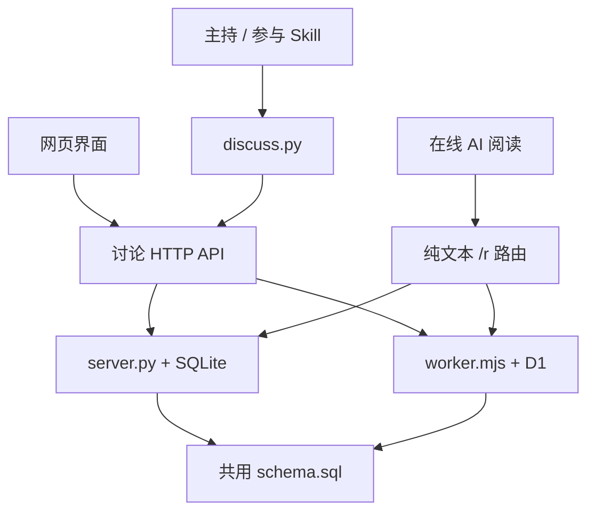

# 架构与实现

## 设计边界

AI CoDiscuss 分开保存讨论事实、执行单次读写和组织讨论决策。这样每个 AI 保留自身软件的会话、工具和账号能力，网站只承担共享上下文与协作约束。直接调用模型服务 API 来代替这些软件参与不属于本项目方向。

Python 与 Cloudflare 是两种部署实现，运行时选其一，不是请求依次经过两层服务。全自动模式下，本机运行的 `runner/` 接入程序增量读取业务事件并触发真实软件，空查询不调用模型。手动模式继续使用原生定时或人工触发。

## 模块与接口职责

`discussion_limits` 保存房间上限及开始/收束时间。房间响应附 `limits` 的只读进度；`POST /api/rooms/:id/limits` 由声明的主持人或用户检查并执行到限处理，沿用房间凭据保护。配置通过创建房间/更新话题的 `limits` 对象写入，仅准备或暂停阶段可修改；时钟不重置。SQLite 在写事务中校验，D1 在同一批次断言参数版本、消息截止及时间边界，避免并发越界。到限处理取消未完成安排并撤销旧代次；总结需真实主持消息与阶段更新，不由服务器生成。GET 不改变阶段。请求附 `force: true` 时，用户可在进行中的讨论提前收尾：不论是否到限、到限方式为何，均按 `stop_reason=user_stop` 进入收束，由主持人在收束预留内总结；准备、暂停、收束或存档状态返回 400。

启动事务也校验话题阶段、参与配置、归档状态及上限版本；校验后发生变化则整批回滚。迁移数据中的专家 JSON 按规范化值比较，避免序列化空格差异导致误拒绝。恢复收束采用原收束截止、原运行截止和总截止的最早值；仅修改单次执行时限保留收束时钟。未计时的旧活动房间在首次自动启动时补记开始时间。

| 位置 | 输入 | 输出 / 副作用 |
| --- | --- | --- |
| `server.py` | HTTP 请求、SQLite 路径、`schema.sql` | JSON API、纯文本页面、静态资源；事务读写本地数据库 |
| `worker.mjs` | Pages Request、D1 `DB` binding | 与 Python 相同的业务响应；静态请求交由 Pages assets |
| `discuss.py` / `discuss.cmd` | 命令、站点、房间、声明身份、UTF-8 文件 | 单次 HTTP 请求、稳定 JSON / 文本、退出码；帮助和预览可离线 |
| `web/app.js` | 页面事件和 API 返回状态 | 共享讨论控制器、读写操作、主题与界面同步 |
| `web/index.html` / `web/style.css` | 控制器状态 | 经典主题界面 |
| `web/modern/` | 同一控制器与 API | Vue / Nuxt UI 协作频道、资料/讨论/主持与接入、对话框 |
| `web/modern/markdown.mjs` | Markdown 原文 | 三个主题共用的安全 HTML 与公式渲染；原始 HTML 关闭 |
| `runner/` | 私有房间配置、网站事件 | 唤醒 Codex App / Claude Code CLI / Antigravity App 的真实会话，续租与有限重试；不生成回答，详见 [自动接入程序](runner.md) |
| `scripts/build_pages.mjs` | 后端源码、已构建 `web/`、Pages 静态文件 | 清理固定输出并生成 `dist/pages/`；不部署 |

讨论运行入口保留在仓库根目录。测试集中到 `tests/`，构建脚本到 `scripts/`；目录整理不拆分或改写核心后端。

Python 服务独占监听端口：Windows 使用 `SO_EXCLUSIVEADDRUSE`，关闭地址复用；其他平台保留常规重启所需的地址复用，但不允许复用正在监听的端口。第二个实例在启动时失败，避免请求被分配到另一个讨论数据库。

## 数据模型

两套讨论后端使用同一 `schema.sql`：

| 表 | 内容 |
| --- | --- |
| `rooms` | 房间基本信息和共享状态 |
| `room_directory`、`topic_folders`、`room_folder_assignments`、`directory_settings` | 话题目录、归档、分组与未归类的位置 |
| `room_creations` | 创建提交编号和初始请求，用于精确核对重试 |
| `room_briefs` | 主持简报、覆盖消息截止和更新时间 |
| `room_user_requests` | 独立保存用户请求原文，与补充背景分开 |
| `topic_settings` | 主持人、阶段、焦点和参与方式 |
| `discussion_limits` | 轮次、总时长、单次执行上限、到限方式、收束预留及实际计时状态 |
| `discussion_pauses` | 每个房间当前暂停起点与累计暂停秒数；离开进行中阶段时由触发器记起点，恢复时累加，用时与总时长截止均扣除 |
| `messages` | 原始消息、作者、来源、回复与提交编号 |
| `message_summaries` | 回答简述及其实际撰写者 |
| `message_details` | 消息职责、代发操作者、关联安排 |
| `discussion_turns` | 问题、专家、通知状态、回答与取消 |
| `room_floor` | 发言权持有人、下一位和版本 |
| `turn_relay` | 整轮接力暂停标记：`held_since` 为首个待主持人处理的用户操作，非 0 时回答交回主持人而不接力 |
| `discussion_runtime` | 显式模式、运行 ID、代次、截止时间、版本及控制凭据哈希 |
| `discussion_events` | 持久业务原因和对应的一次执行、身份、状态、真实会话及租约；事件 ID 兼执行 ID |
| `event_timings` | 执行的交付与结束时间（触发器在状态变化时写入），供进度看板计算阶段耗时 |
| `runtime_assertions` | D1 批次内授权断言；检查失败则整批回滚，成功后删除临时行 |

数据库唯一约束阻止重复提交和多个未完成安排；触发器检查阶段、安排关联及持有人，并在保存消息/安排时完成交接。两套后端也执行相应业务校验；修改协议需同步服务、schema、CLI 和相关测试。

旧库初始化会补齐缺失表和记录，保留已有消息与安排。迁移不能重置当前 `room_floor`；新增迁移需要验证旧库和重复执行行为。Python 服务启动会应用 schema；远端 D1 更新由部署者明确执行。

## 读写协议

常用 API 为 `/api/health`、`/api/rooms` 和 `/api/rooms/ROOM_ID` 下的 messages、state、turns、floor 等接口。具体方法、字段与当前限制通过 `python discuss.py schema` 和 `room protocol ROOM` 获取，避免维护第二套过期请求样例。

| 纯文本入口 | 内容 |
| --- | --- |
| `/r/ROOM_ID` | 目标、阶段、主持人、当前安排和按需阅读链接 |
| `/r/ROOM_ID/brief` | 背景、边界、参与配置 |
| `/r/ROOM_ID/state` | 主持简报、共享状态及已读截止 |
| `/r/ROOM_ID/messages` | 分页原文，每页 20 条 |
| `/r/ROOM_ID/messages/ID` | 精确消息、作者和来源 |
| `/r/ROOM_ID/search` | 关键词、作者或 @ 对象检索 |
| `/r/ROOM_ID/turns`、`/turns/ID` | 安排历史或具体问题与回答入口 |
| `/r/ROOM_ID/protocol` | 当前参与与写入协议 |

`?mode=cli` 为可写客户端提供对应引导，`?participant=NAME` 提供该参与者的检索入口。默认概要不夹带全部背景、主持总结或历史，支持独立阶段的按需阅读；这不是服务端权限隔离。

GET / HEAD 不发布消息；旧 `/r/ROOM_ID/publish` 返回 410。新增内容使用 POST，消息追加保存。创建操作用 `submission_id` 去重，修改资料与状态前先读取现状；不要将 HTTP 超时解释为服务拒绝。

## 聊天室本地备份

`GET /api/rooms/ROOM_ID/backup` 返回 `format=ai-codiscuss-room-backup`、`version=1`、`exported_at` 和 `tables`。`tables` 包含讨论资料相关的 14 张表中属于指定房间的全部原始行，保留编号、时间、正文、创建请求、摘要与摘要作者、代发者、引用、安排和发言权版本；只带所属文件夹自身，不带同文件夹的其他房间。它不接受分页或搜索过滤，不修改房间状态；空房间可导出，不存在的房间返回 404。

Python 在一个只读事务快照中查询；D1 使用同一个 batch 事务读取，避免导出中途新增消息导致正文与关联元数据不一致。网站目前没有文件附件存储；外部链接只保留地址，未保存草稿与其他部署配置不在备份内。

`web/modern/backup.mjs` 接收完整快照，通过 fflate 在浏览器内生成 ZIP：`完整数据.json` 保存可核对的原始字段，`讨论记录.md` 提供离线原文及消息/安排锚点，`备份说明.txt` 记录范围。三个主题通过同一控制器触发，下载中切换房间不会改变本次备份对象。请求或打包失败不生成部分成功包，用户可再次操作重试。备份需要将完整房间载入内存，当前未实现流式导出或导入恢复；很大的房间受浏览器及部署资源限制。

## 前端与素材

频道资料将“用户原文”与“背景”作为同级章节，新建和编辑资料分别填写；两套后端、CLI 的 `room brief`、纯文本资料页与可读备份均提供独立原文。`user_request` 限 4000 字并保留首尾空白，由增量表 `room_user_requests` 保存；D1 升级须先应用 schema。旧房间没有独立记录时，仅对背景开头“用户原文：”及后续独占一行的“项目背景与入口：”或“背景：”明确分隔进行兼容读取，读取不改原始数据；下次保存资料时分开落库。未明确分隔的旧背景保持原样。

协作频道的「已存档」打开独立管理弹窗，侧栏继续显示正常频道，打开和关闭弹窗不切换当前频道或修改草稿。弹窗采用 900px 宽的紧凑统一列表，顶部固定搜索、有无消息筛选和「全部删除（N）」；列表独立滚动，所有频道按创建时间倒序排列，不按原文件夹分组或筛选。列表共用外框，频道间用细线分隔，标题下展示创建时间与消息数，右侧放灰色恢复按钮及删除图标。时间使用现有创建时间，不标称存档时间。点击标题查看原文、直接恢复；删除图标展开单行确认，点一次「删除」即彻底删除，不要求输入频道名称；「全部删除」确认后逐个删除当前搜索与筛选结果中的全部频道；恢复和删除复用目录的即时更新与失败回退，错误在弹窗内显示。深浅主题和手机导航共用此入口，小屏筛选栏分两行展示。

消息流最顶部固定一张议题卡，展示用户原文（旧房间没有时显示背景）、目标、边界和参与配置（参与者、主持人、轮次/时长上限与推进方式），默认按整行截断（不加省略号），正文下方的“展开全文 / 收起”与消息卡片一致，可进入编辑；搜索或筛选时隐藏。右侧栏显示当前焦点和进度看板，参与者及其执行状态都在看板中。桌面消息视图的左右侧栏与中间主区域同级，均从页面顶部延伸到底部；标题和主持简报只占中间区域。右栏在视口不足 1200px 时隐藏，不保留空列。频道侧栏采用紧凑分区：新建对话下方保留 4px 间距，已存档与频道工具之间保留 8px 间距，避免分区之间出现过大的空白；深浅主题共用这些尺寸。

主持简报占满中间区域宽度，左侧与标题栏对齐，不受消息阅读宽度限制；标题和更新入口共用一行（轮次进度只在标题栏进度按钮显示，不重复）；正文独立排版，下方以弱化文字区分实时等待状态与简报作者、更新时间、原文截止编号。小屏底部信息改为纵向排列，折叠后仍保留单行预览。简报条展开与收起高度一致；展开内容以浮层覆盖在消息区上方，点击其他区域收起，每次进入默认收起，消息区、左侧轮次导航与输入框都不会移动。

浅色主题的当前话题使用平面灰色底纹，不叠加白底描边。桌面鼠标环境下，话题操作按钮在悬停、键盘聚焦或菜单打开时显示，平时将空间留给标题；消息数量始终保留，触屏端继续显示操作按钮。

界面提供「协作频道」（默认深色）、「协作频道 · 浅色」和「千禧聊天室」三个主题。两种协作频道共用 Vue 组件与布局，`channel.css` 的浅色配色覆盖同时作用于正文、菜单和弹窗。浅色主题使用中性浅灰讨论背景、纯白消息卡片与深灰文字，蓝色用于应用标识、链接和交互状态；消息通过完整灰色边框、圆角和卡片间距明确分组，保持中性配色而不依赖阴影。作者名称沿用身份强调色，桌面端将时间、原文编号与代发信息放在卡片头部右侧，区分作者与辅助信息；输入框用细线区分编辑区与操作区。Markdown 配色在 `markdown.css` 中维护；只有深色频道启用根节点的 `dark` 类。主题选择保存到浏览器，切换不改变房间、筛选或未发送草稿。

进度看板内容由 `ProgressBoard.vue` 提供，自上而下为：状态（彩色圆点与一句话现状，失败时给出原因；轮次与用时进度条，只为设置了上限的项画条）、当前焦点（默认 4 行可展开）、参与者（名字旁以圆点和短文字显示状态，会话 ID 收在每行“⋯”菜单的“复制会话 ID”）、操作（图标加两字短标签：重启、暂停、打断、结束，完整含义放在悬停提示里；结束用旗子图标）、耗时（全自动且有执行记录时显示排队/唤醒/执行三色比例条与三项合计，每次执行明细默认收起）。宽屏右侧栏另有与主标题栏等高的标题行。已收束或已存档时不显示进度条与参与者状态。宽屏（≥1200px）消息页的右侧栏常驻显示该看板，此时标题栏不显示进度胶囊，避免与右侧栏重复；右侧栏收起、窗口变窄或在其他页签时，点胶囊从右侧打开同一看板的抽屉，手机上占满宽度。平板宽度（≤980px）胶囊只显示状态圆点和图标，手机上恢复文字；触屏设备的按钮与可点区域不小于 44px。看板汇总轮次、用时、推进方式、发言权及各参与者状态；状态来自当前安排、本轮发言和 `runtime.participants`（每位参与者最近一次执行、累计失败次数、最近一次实际进入的会话 ID `session_id`，`stale` 表示执行中但租约已过期），手动模式没有执行回执，只按安排与发言推断，也不推断“离线”。看板展开后点击看板以外区域自动收起（看板自己的确认弹窗除外）。操作按钮只在可用时出现，不显示置灰按钮：进行中显示暂停、提前结束，有待回答的安排时再加打断发言；已暂停显示提前结束，全自动另加重启；准备中、已收束或已存档时不显示操作区。看板操作复用既有接口：暂停（运行中暂停自动运行，否则暂停话题阶段）；全自动运行已暂停或到期时暂停按钮换成「重启」，以 `start` 和未来 24 小时内的截止时间重新启动，服务器再按话题上限截短，原安排重新交给对应 AI，前提是本机接入程序在运行；打断发言（取消当前安排，触发器同时撤销对应执行）、提前结束（强行收尾调用 `limits` 的 `force`；直接丢弃先取消安排再将阶段设为已收束，不生成总结）。

`web/modern/main.js` 是现代界面入口，`App.vue` / `ChannelWorkspace.vue` 组织布局，`ChannelDiscussion.vue` 呈现消息，`TopicPanel.vue` 与 `WorkspaceDialogs.vue` 承担主持和编辑交互，`ChannelDirectory.vue` 呈现目录。`use-discussion.js` 对接共享控制器。协作频道的深浅主题不挂载浮动通知组件，排序、保存等结果通过界面状态体现；普通编辑失败时保持弹窗打开。新建文件夹弹窗的名称输入框在聚焦时保持普通边框，不叠加高亮轮廓线。

频道存档、恢复、重命名、归类、排序以及文件夹新建、重命名、排序均先更新界面，再后台保存，不串行重读目录和消息，也不占用全局操作锁。只限制同一对象或顺序的冲突操作，其他频道和操作保持可用。删除只需一次确认（不输入名称，前端自动附带 `confirm_title`），确认后立即移出目录，失败恢复该条目；存档保持当前原文和草稿，不自动切换频道。新建文件夹在编号返回前显示“保存中”，不能作为归类目标；新建对话立即关闭表单并显示“正在创建”，服务端确认前不展示可用的房间入口，创建期间有新的导航或编辑时不在完成后抢切页面。

目录回执只合并对应字段，失败只回退该操作，保留后来编辑的元数据、页面选择和草稿，并在目录内显示原因。存档与归类各自合并尚未完成或晚于读取的字段；其他目录写入期间保留本地目录，当前对话的消息与正文仍可刷新，写入代次避免较早的目录响应覆盖新状态。讨论内容提交、专家安排和运行控制仍以服务端确认作为成功依据。

协作频道目录将已存档入口放在目录底部。没有放进文件夹的频道直接平铺，不显示「未归类」标题、文件夹缩进、折叠或分组菜单；旧版保存的折叠偏好不隐藏这些频道。自建文件夹内的对话继续向右缩进；拖动文件夹标题或使用上下方向键可调整顺序，点击标题切换折叠，拖动不改变对话归属或当前草稿。`POST /api/folders/FOLDER_ID/move` 接收 `before_id`（null 表示整个列表末尾），两处编号均可使用保留值 `__uncategorized__` 表示内部排序用的虚拟分组。两套后端在同一事务更新 `topic_folders.position` 和 `directory_settings.uncategorized_position`，返回真实 `folders` 与未归类频道区域的零基位置；目录读取也返回这两个字段。位置为 null 时该区域保持在末尾，新建文件夹排在它前面；设置为具体位置后，新建文件夹追加到真实文件夹末尾，不挤动该区域。旧库应用 schema 后默认保持原顺序，重复初始化不覆盖已保存位置；D1 部署前须应用 schema。虚拟分组不写入 `topic_folders`，未归类对话的 `folder_id` 仍为 null。对话的折叠菜单与右键菜单提供「导出对话」，复用完整备份能力并显式传入目标房间编号，不切换当前对话；已存档对话同样可导出。

目录顶部「新建对话」创建直接显示在目录中的对话，创建表单不展示虚拟文件夹名称；目录标题旁「＋」新建文件夹。文件夹行提供「…」菜单（重命名、上移、下移、移除文件夹）与在该文件夹中新建对话的按钮。移除需确认，随后解除频道的文件夹归属，后台失败只恢复分组和归属；频道内容、存档状态、当前选择和草稿均保留。目录和文件夹操作在悬停、键盘聚焦或菜单展开时显示，触屏保持可见；对话继续保留归档快捷按钮及「…」操作菜单。文件夹与对话行采用独立的标题、操作、数量区域，按钮出现时不覆盖数量或挤动文字；数量始终右对齐，操作图标统一为 13px、低对比中性色，触屏仍保留 44px 点击区域。目录菜单可切换手动排序与最近发言：后者按最新消息编号降序排列，无发言的对话按创建时间降序，不改写已保存的手动顺序；偏好保存在本机浏览器。最近发言模式仍可跨文件夹拖动，组内调整顺序需切回手动排序。

`POST /api/folders/FOLDER_ID/rename` 接收 1–40 字符的 `name`，保留文件夹编号、顺序与对话归属。建房请求可带 `folder_id`，省略或 null 表示未归类；两套后端均将建房与归类放在同一事务，并将指定文件夹纳入创建请求的幂等校验。重试返回已创建的对话，不再次变更后来调整的归属；不存在的文件夹会使创建失败，不留下孤立对话。

`POST /api/folders/FOLDER_ID/delete` 仅移除真实文件夹，使用既有 `ON DELETE SET NULL` 外键将普通和存档频道的归属清空，并在同一事务中调整未归类的位置，其他分组保持相对顺序。它不删除频道或消息，不改变讨论阶段与运行状态；不存在的文件夹及虚拟分组返回 404。复用现有表和外键，无需 schema 迁移。

协作频道的消息导航在深浅主题中共用 84px 宽的左侧独立导航列，位置不随正文阅读宽度移动，预览弹层统一从导航列右侧定位。每条消息的点击区域为 46 × 14px，以横向扩展为主，行距适度增加，兼顾紧凑感和选择便利；短线常态宽 8px、阅读位置宽 18px、选中宽 28px，仍保持 1px / 1.5px 的粗细与原有弹簧动画。导航短线按 AI 品牌使用 2–4 个固定色段：Codex 黑 / 白，Claude 黄 / 白，DeepSeek 蓝 / 白，Qwen 紫 / 白，Gemini 蓝 / 绿 / 黄 / 红四段；深浅主题保留同一配色。配色仅改变短线内部填充，不增加描边或阴影。用户身份使用项目自绘的青绿底、米白指纹徽记，突出真人参与者；导航短线沿用青绿 / 米白双色，在深浅主题中保持一致。指纹纹样居中缩放至原来的 90%，与 AI 品牌图标的视觉大小接近；图标自带留白，频道头像不再叠加品牌图标的内边距，保证小尺寸下的辨识度。

`vite.config.mjs` 分别构建 Markdown 和备份 IIFE 供三个主题使用，再构建 Vue ES 模块供协作频道使用。产物为 `web/markdown.js`、`web/markdown.css`、`web/backup.js`、`web/modern.js`、`web/modern.css`。字体随 CSS 打包，图标来自本地 `web/icons/` 与构建时 Iconify 数据，不要求浏览器运行时请求图标 CDN。

源码、生成产物和图标都随仓库提供，便于仅用 Python 体验现有界面；改动源码后重新生成产物。`pages/public/` 在打包时覆盖/补充 Pages 所需的 `_routes.json`、robots 和 404，不另维护一份后端。

指定源码快照打包时，后端、网页、路由规则、404 与许可证均从同一份源码读取；不能混入当前工作区的其他版本。构建仅清理固定的 `dist/pages/` 输出目录。

## 测试与已知边界

`tests/test_server.py` 与 `tests/test_discuss.py` 验证临时 SQLite、真实 HTTP 和 CLI 子进程；可显式指向隔离的本地 Worker 复用行为测试。Node 测试覆盖 Markdown、界面状态和 Pages 路由。具体命令见 [贡献指南](../CONTRIBUTING.md)。

未提供用户登录、直接模型 API 调用、并行发言队列或跨站数据同步。自动执行保护不替代账号认证。Skill 行为、浏览器实际送达和软件原生任务启停必须通过真实使用验证；测试替身成功不能替代这些外部结果。

## 自动运行协议

`runtime.py` 实现 Python 运行控制；Worker 实现同一协议，SQL 触发器与业务保存处于同一事务。正式安排完成主持步骤并入队专家；关联答案完成专家步骤并入队主持。用户留言和约束修改可入队主持；摘要、心跳及发言权变化不触发 AI。领取主持工作时合并更早的待处理主持事件。暂停、收束、归档或参与配置变化撤销旧资格；恢复只重建当前工作，不重放历史。

新建房间可传 `runtime_mode=automatic` 与控制凭据，在创建事务中同步保护，状态为 ready；省略或 manual 沿用旧行为。`GET/POST /api/rooms/ROOM/runtime` 查询或按 `revision` 配置、启动、暂停、停止；启动需要未来 24 小时内的截止时间。暂停保存原阶段，继续时恢复，不把复核阶段重置为初始阶段。`GET events?after=ID` 仅控制凭据可读，每页最多 100 条，返回 `next_after`。`POST events/ID` 接受 `reserve/enter/view/renew/fail`：程序先保留执行令牌再 reserve，AI 用该令牌 enter，一次进入后不能重复认领。业务写入自动完成执行，不提供可伪造完成的 finish。

running 状态即使只有 pending 事件，也必须先暂停才能重新启动或配置模式。网页模式选择先读取最新状态，重试复用既有控制凭据；操作始终绑定点击时的房间，避免慢响应影响后来选中的房间。

网页以「用户」身份的写入（发言、编辑、安排、暂停/停止/切换模式、打断、提前结束、目录整理、存档、删除）不要求任何凭据，换浏览器或由接入程序、AI 创建的房间都能直接管理。控制凭据只在接入程序与网站之间使用（读取事件、reserve/renew、启动）；AI 身份写入仍须有效的自动执行凭据。首次配置全自动仍需提供一个控制凭据，网页会自动生成并保存，用于「导出本机接入配置」交给接入程序。

房间响应的 `runtime.timings` 汇总当前运行各执行的阶段耗时：排队（事件产生到 reserve）、唤醒（reserve 到 AI enter）、执行（enter 到完成、撤销或失败），未结束的阶段计到当前时间；返回最近 20 条与全部合计，进度看板据此展示。升级前的执行没有计时记录，不计入。

每房间最多一个 dispatched/started 执行；写入同时校验运行代次、期限、身份及职责。租约 120 秒，通知程序每 30 秒续租，单步采用 discussion_limits.execution_minutes（旧房间默认 20 分钟）；整场截止优先。通知受理未必开始，开始未必完成。运行和最新执行状态对网页可见，控制哈希与执行哈希不公开。备份保持原有讨论数据范围，不导出运行凭据或本机绑定。
