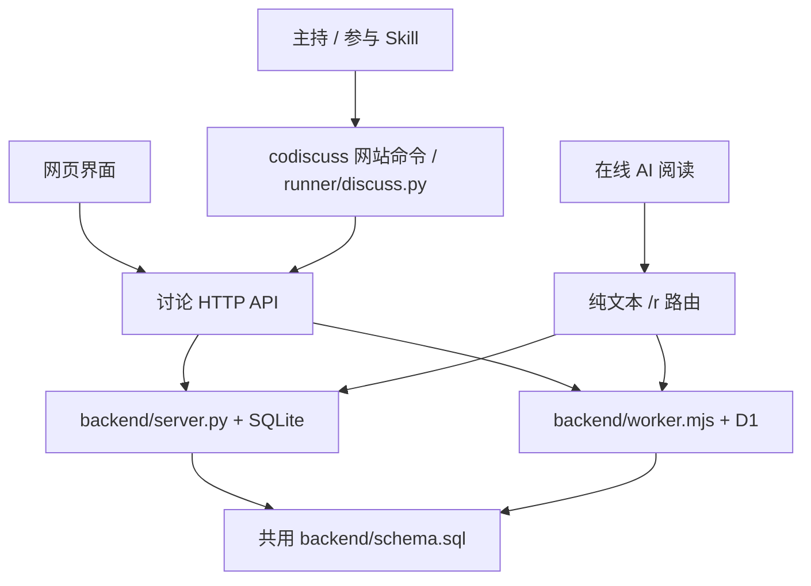

# 架构与实现

## 设计边界

AI CoDiscuss 分开保存讨论事实、执行单次读写和组织讨论决策。这样每个 AI 保留自身软件的会话、工具和账号能力，网站只承担共享上下文与协作约束。直接调用模型服务 API 来代替这些软件参与不属于本项目方向。

Python 与 Cloudflare 是两种部署实现，运行时选其一，不是请求依次经过两层服务。全自动模式下，本机运行的 `runner/` 接入程序增量读取业务事件并触发真实软件，空查询不调用模型。手动模式继续使用原生定时或人工触发。

## 模块与接口职责

| 位置 | 输入 | 输出 / 副作用 |
| --- | --- | --- |
| `backend/server.py` | HTTP 请求、SQLite 路径、`backend/schema.sql` | JSON API、纯文本页面、静态资源；事务读写本地数据库；根目录 `server.py` 调用其启动函数 |
| `backend/worker.mjs` | Pages Request、D1 `DB` binding | 与 Python 相同的业务响应；静态请求交由 Pages assets |
| `backend/free_room.py` | 两种房间的成员登记，以及自由房间的请求与执行 | 独立成员凭证、按成员的执行唯一性、打断与失败隔离；只由 Python 后端调用，见 [自由协作协议](#自由协作协议) |
| `backend/updates.mjs` | Pages 可选 `UPDATES` Durable Object binding | 跨 Worker 实例广播网页变更通知；不保存讨论数据，不提供公开发布入口 |
| `runner/codiscuss.mjs` | 统一 `codiscuss` 命令与原样参数 | 无子命令时启动本机服务，`service` 管理进程；网站命令转交 Python 客户端，保留 stdin、相对路径与退出码 |
| `runner/discussion_launch.mjs` | 本机默认软件配置、单场启动配置、对话 / 网页入口 | 校验后建房、保存私有配置、启用运行并登记接入服务；对话入口将首个主持任务交回当前会话；暂停后可凭原控制凭据和版本修正本场软件路径或切换 Codex App / CLI，保留原会话绑定，不自动重启 |
| `runner/discussion_models.mjs` | 本机 CLI 模型目录 | 只执行 Codex 模型列表、Claude 初始化或 agy models，返回模型与档位，不发送提示词；查询后关闭临时进程 |
| `runner/discussion_setup.mjs` / `discussion_skills.mjs` / `discussion_tui.mjs` | npm 包、已有 Python / CLI、选定软件 | 持久安装统一命令，合并本机软件配置，复制完整技能并保留本地修改；`discussion_tui.mjs` 只负责安装过程的终端呈现；不创建讨论 |
| `runner/discussion_local.mjs` | 用户服务目录、Python 和端口配置 | 后台网站及包外 SQLite，复用讨论服务、检查就绪、仅停止拥有的进程 |
| `runner/discuss.py` | 命令、站点、房间、声明身份、UTF-8 文件 | 网站客户端实现；单次 HTTP 请求、稳定 JSON / 文本、退出码，帮助和预览可离线，可直接用 Python 执行 |
| `web/app.js` | 页面事件和 API 返回状态 | 共享讨论控制器、读写操作、主题与界面同步 |
| `web/index.html` | 控制器状态 | Vue 挂载点、共享控制器的隐藏表单适配层与附件预览对话框 |
| `frontend/` | 同一控制器与 API | Vue / Nuxt UI 协作频道、资料/讨论/主持与接入、对话框 |
| `frontend/markdown.mjs` | Markdown 原文 | 三个主题共用的安全 HTML 与公式渲染；原始 HTML 关闭 |
| `runner/` | 私有房间配置、网站事件 | 接入 Codex App / CLI、Claude Code CLI、Antigravity App / CLI 的真实会话，续租与有限重试；`discussion_service.mjs` 常驻托管多个已登记房间；不生成回答，详见 [自动接入程序](runner.md) |
| `runner/free_runner.mjs` | 自由房间的 inbox、私有房间配置 | 把成员名下的全部待投递请求打包为一次执行，复用同一组软件适配器；只停止该成员自己的进程 |
| `scripts/build_pages.mjs` | 后端源码、已构建 `web/`、Pages 静态文件 | 清理固定输出并生成 `dist/pages/`；不部署 |

两套后端、Python 运行协议与共用 schema 位于 `backend/`；前端源码及 Vite 配置在 `frontend/`，静态运行文件在 `web/`，测试和构建脚本分别在 `tests/`、`scripts/`。`deploy/` 保存 Docker 文件，`.github/` 保存 CI、贡献指南和安全说明，第三方声明位于 `docs/`。根目录保留用户启动入口和工具约定的配置文件；`python server.py` 仍以项目根目录定位网页与默认数据库，不受终端工作目录影响。

Python 服务独占监听端口：Windows 使用 `SO_EXCLUSIVEADDRUSE`，关闭地址复用；其他平台保留常规重启所需的地址复用，但不允许复用正在监听的端口。第二个实例在启动时失败，避免请求被分配到另一个讨论数据库。

`--local-launch` 是仅限回环监听的可选本机控制接口，公开部署默认关闭。本机网页使用同源请求；`codiscuss local connect SITE` 为指定 HTTPS 来源生成连接凭据后，线上浏览器也可直接调用该电脑的接口。连接信息保存在浏览器本地存储，本机 `site-connections.json` 仅存来源与凭据哈希；不扫描公开房间或自动接管未明确启动的讨论。来源和凭据验证通过后，接口把 `site` 固定为该来源，再经固定 Node 入口调用共享启动器；路径与连接凭据不经过线上服务器。启动器复用两套后端已有建房、运行、事件协议，Cloudflare 不提供进程启动接口，无需新增 D1 表。网页的启动配置由 `frontend/LaunchSettings.vue` 与共享控制器维护，深浅频道主题使用同一启动请求。

网页在请求前按原提交号或房间保存完整待办；展示快照仅含标题、房间编号与错误，不包含待办中的凭据或私有配置。刷新后的恢复必须由用户显式触发，重放原输入进入启动器已有日志；每次发送的独立编号防止跨标签迟到失败覆盖较新的待办状态。本机桥接保留启动器的部分失败阶段，只有控制权验证后才返回原房间编号；浏览器请求必须显式携带控制凭据，不回退到磁盘中的凭据代为认领。网站业务协议和 Cloudflare 后端不受此本机恢复接口变更影响。

## 数据模型

两套讨论后端使用同一 `backend/schema.sql`：

| 表 | 内容 |
| --- | --- |
| `rooms` | 房间基本信息和共享状态 |
| `room_directory`、`topic_folders`、`room_folder_assignments`、`directory_settings` | 话题目录、归档、分组与未归类的位置 |
| `room_creations` | 创建提交编号和初始请求，用于精确核对重试 |
| `room_briefs` | 主持简报、覆盖消息截止和更新时间 |
| `room_user_requests` | 独立保存用户请求原文，与补充背景分开 |
| `topic_settings` | 主持人、阶段、焦点和参与方式 |
| `discussion_limits` | 轮次、总时长、单次执行上限、到限方式、收束预留及实际计时状态 |
| `discussion_pauses` | 每个房间当前暂停起点与累计暂停秒数；离开进行中阶段时由触发器记起点，恢复时累加，用时与总时长截止均扣除 |
| `messages` | 原始消息、作者、来源、回复与提交编号 |
| `attachments` | 附件元数据、上传者、提交编号、SHA-256 与消息中的顺序；字节存于磁盘或 R2 |
| `message_summaries` | 回答简述及其实际撰写者 |
| `message_details` | 消息职责、代发操作者、关联安排 |
| `message_timings` | 自动执行从交付唤醒到消息保存的秒数，随消息固定保存 |
| `discussion_turns` | 问题、专家、通知状态、回答与取消 |
| `room_floor` | 发言权持有人、下一位和版本 |
| `turn_relay` | 整轮接力暂停标记：`held_since` 为首个待主持人处理的用户操作，非 0 时回答交回主持人而不接力 |
| `discussion_runtime` | 显式模式、运行 ID、代次、截止时间、版本及控制凭据哈希 |
| `discussion_events` | 持久业务原因和对应的一次执行、身份、状态、真实会话及租约；事件 ID 兼执行 ID |
| `event_timings` | 执行的交付与结束时间（触发器在状态变化时写入），供进度看板计算阶段耗时 |
| `runtime_assertions` | D1 批次内授权断言；检查失败则整批回滚，成功后删除临时行 |

数据库唯一约束阻止重复提交和多个未完成安排；触发器检查阶段、安排关联及持有人，并在保存消息/安排时完成交接。两套后端也执行相应业务校验；修改协议需同步服务、schema、CLI 和相关测试。

旧库初始化会补齐缺失表和记录，保留已有消息与安排。迁移不能重置当前 `room_floor`；新增迁移需要验证旧库和重复执行行为。Python 服务启动会应用 schema；远端 D1 更新由部署者明确执行。

频道资料将“用户原文”与“背景”作为同级章节，新建和编辑资料分别填写；两套后端、CLI 的 `room brief`、纯文本资料页与可读备份均提供独立原文。`user_request` 限 4000 字并保留首尾空白，由增量表 `room_user_requests` 保存；D1 升级须先应用 schema。旧房间没有独立记录时，仅对背景开头“用户原文：”及后续独占一行的“项目背景与入口：”或“背景：”明确分隔进行兼容读取，读取不改原始数据；下次保存资料时分开落库。未明确分隔的旧背景保持原样。

## 读写协议

常用 API 为 `/api/health`、`/api/rooms` 和 `/api/rooms/ROOM_ID` 下的 messages、state、turns、floor 等接口。具体方法、字段与当前限制通过 `codiscuss schema` 和 `codiscuss room protocol ROOM` 获取；原 Python 入口继续兼容，避免维护第二套过期请求样例。

附件使用 `/api/rooms/ROOM_ID/attachments`：POST 接收原始字节，查询参数为 `actor`、`file_name`、`submission_id`，限制 20 MiB；GET 默认分页列出已发送文件，也可用 `submission_id` 精确核对尚未关联消息的上传。`/attachments/ID` 返回元数据，`/attachments/ID/content` 返回原文件，`?download=1` 强制下载。消息传有序 `attachment_ids`（最多 10 个、不重复），可以只有附件；关联与消息在同一事务保存，同编号重试比较原文及附件顺序。

附件编号为随机值，文件名不参与存储路径。Python 存于 `<数据库绝对路径>.attachments/`，Pages 使用 `ATTACHMENTS` R2 binding；未配置 R2 时上传返回 503，不影响文字讨论。上传受同一房间写入凭据约束，自动任务须在回答完成前上传；消息只可关联同房间、同实际提交者且未被其他消息占用的附件。读取沿用网站现有公开边界。删除房间同时尝试删除原文件；未发送的上传保留到房间删除，不列入普通列表或备份。

服务端只将文件头识别的 PNG/JPEG/GIF/WebP/PDF 作为可预览类型，其他类型以二进制下载并设置 `nosniff`。网页共用选择、拖拽和截图粘贴；图片直接按原比例展示缩略图，点击用原生对话框放大，文件则使用类型图标、名称、大小和下载按钮组成的紧凑横向卡片，避免把图片套进文件信息框。发送前同样区分图片缩略图和文件卡片，可逐个移除；扩展名图标仅用于识别，不决定预览能力。PDF.js 及字体、解码资源随 `web/pdfjs/` 本地打包，按页渲染并限制画布尺寸。网页不抽取文本、不转换 Office，也不替 AI 读取文件。备份把已发送原文件加入 ZIP 的 `附件/`，保留编号、校验值及本地相对链接；文件缺失或校验失败则不生成部分备份。

| 纯文本入口 | 内容 |
| --- | --- |
| `/r/ROOM_ID` | 目标、阶段、主持人、当前安排和按需阅读链接 |
| `/r/ROOM_ID/brief` | 背景、边界、参与配置 |
| `/r/ROOM_ID/state` | 主持简报、共享状态及已读截止 |
| `/r/ROOM_ID/messages` | 分页原文，每页 20 条 |
| `/r/ROOM_ID/messages/ID` | 精确消息、作者和来源 |
| `/r/ROOM_ID/search` | 关键词、作者或 @ 对象检索 |
| `/r/ROOM_ID/turns`、`/turns/ID` | 安排历史或具体问题与回答入口 |
| `/r/ROOM_ID/protocol` | 当前参与与写入协议 |

`?mode=cli` 为可写客户端提供对应引导，`?participant=NAME` 提供该参与者的检索入口。默认概要不夹带全部背景、主持总结或历史，支持独立阶段的按需阅读；这不是服务端权限隔离。

GET / HEAD 不发布消息；旧 `/r/ROOM_ID/publish` 返回 410。新增内容使用 POST，消息追加保存。创建操作用 `submission_id` 去重，修改资料与状态前先读取现状；不要将 HTTP 超时解释为服务拒绝。

### 目录写入

`POST /api/folders/FOLDER_ID/move` 接收 `before_id`（null 表示整个列表末尾），两处编号均可使用保留值 `__uncategorized__` 表示内部排序用的虚拟分组。两套后端在同一事务更新 `topic_folders.position` 和 `directory_settings.uncategorized_position`，返回真实 `folders` 与未归类频道区域的零基位置；目录读取也返回这两个字段。位置为 null 时该区域保持在末尾，新建文件夹排在它前面；设置为具体位置后，新建文件夹追加到真实文件夹末尾，不挤动该区域。旧库应用 schema 后默认保持原顺序，重复初始化不覆盖已保存位置；D1 部署前须应用 schema。虚拟分组不写入 `topic_folders`，未归类对话的 `folder_id` 仍为 null。

`POST /api/folders/FOLDER_ID/rename` 接收 1–40 字符的 `name`，保留文件夹编号、顺序与对话归属。建房请求可带 `folder_id`，省略或 null 表示未归类；两套后端均将建房与归类放在同一事务，并将指定文件夹纳入创建请求的幂等校验。重试返回已创建的对话，不再次变更后来调整的归属；不存在的文件夹会使创建失败，不留下孤立对话。

`POST /api/folders/FOLDER_ID/delete` 仅移除真实文件夹，使用既有 `ON DELETE SET NULL` 外键将普通和存档频道的归属清空，并在同一事务中调整未归类的位置，其他分组保持相对顺序。它不删除频道或消息，不改变讨论阶段与运行状态；不存在的文件夹及虚拟分组返回 404。复用现有表和外键，无需 schema 迁移。

## 聊天室本地备份

`GET /api/rooms/ROOM_ID/backup` 返回 `format=ai-codiscuss-room-backup`、`version=1`、`exported_at` 和 `tables`。`tables` 包含讨论资料相关的 16 张表中属于指定房间的原始行，保留编号、时间、正文、创建请求、摘要与摘要作者、代发者、引用、安排、消息耗时、已发送附件元数据和发言权版本；只带所属文件夹自身，不带同文件夹的其他房间。它不接受分页或搜索过滤，不修改房间状态；空房间可导出，不存在的房间返回 404。

Python 在一个只读事务快照中查询；D1 使用同一个 batch 事务读取，避免导出中途新增消息导致正文与关联元数据不一致。浏览器随后下载快照中不可变的附件原文件；外部链接只保留地址，未发送上传、未保存草稿与其他部署配置不在备份内。旧版快照缺少 `attachments` 时仍可导出。

`frontend/backup.mjs` 接收完整快照，通过 fflate 在浏览器内生成 ZIP：`完整数据.json` 保存可核对的原始字段，`讨论记录.md` 提供离线原文及消息/安排锚点，`备份说明.txt` 记录范围。三个主题通过同一控制器触发，下载中切换房间不会改变本次备份对象。请求或打包失败不生成部分成功包，用户可再次操作重试。备份需要将完整房间载入内存，当前未实现流式导出或导入恢复；很大的房间受浏览器及部署资源限制。

## 前端与素材

### 源码与构建

`frontend/` 保存 Vue、Markdown 和备份源码；`web/` 保存共享控制器、HTML 入口、图标和构建产物。生成产物随仓库提供，保证仅安装 Python 的用户也能运行网页；不在生成文件中手工修改功能。

| 源码 | 职责 |
| --- | --- |
| `main.js`、`App.vue`、`ChannelWorkspace.vue` | 协作频道入口、主题与整体布局 |
| `ChannelDirectory.vue` | 频道、文件夹和存档管理 |
| `ChannelDiscussion.vue` | 议题卡、消息流、原文导航和输入区 |
| `TopicPanel.vue`、`WorkspaceDialogs.vue` | 话题资料、主持操作、接入步骤及编辑对话框 |
| `CreateDiscussion.vue`、`LimitPicker.vue`、`LaunchSettings.vue` | 新建讨论表单及本机启动配置；推进方式与参与专家分组，单选方式使用强调色卡片，参与者通过“邀请 AI”加入并独立移出；轮次和时长独立配置，以“不限”按钮切换各自上限，按需展开滚轮，选择即时生效，并预览到限条件；鼠标滚轮逐格切换且不产生惯性，鼠标及触摸拖动松手后保留惯性，先阻尼滑行再吸附预计停点，轻点中间数字精确输入；键盘聚焦和直接输入时仅高亮中间选中行，输入与显示共用行高，避免整列描边与原生输入框叠加；时长分小时/分钟两列，收起与摘要共用时长格式；支持键盘，减少动态效果时保留拖动惯性并去掉三维翻转 |
| `ProgressBoard.vue`、`ProgressPanel.vue` | 共享进度看板及抽屉容器；Codex 参与者菜单内直接打开 App / CLI 切换弹窗，显式暂停后复用本场配置的读取与保存，不跳转接入页或自动重启 |
| `use-discussion.js` | 将 `web/app.js` 的共享控制器状态接入 Vue |
| `theme.css`、`channel.css` | 组件主题、深浅配色与响应式布局 |
| `markdown.mjs`、`markdown.css`、`backup.mjs` | 三个主题共用的内容渲染与本地导出 |

`frontend/vite.config.mjs` 构建三个入口：Markdown IIFE、备份 IIFE 和 Vue ES 模块，由根目录 npm 脚本显式指定配置。输出为 `web/markdown.js`、`web/markdown.css`、`web/backup.js`、`web/modern.js`、`web/modern.css`。字体随 CSS 打包，图标来自本地 `web/icons/` 与构建时 Iconify 数据，无需运行时请求图标 CDN。

`scripts/build_pages.mjs` 将静态运行文件、`backend/worker.mjs` 和许可证汇集到 `dist/pages/`；`pages/public/` 补充路由、robots 和 404。它只清理固定输出目录，指定源码快照时全部文件取自同一快照，并兼容整理前的文件布局，不混入工作区其他版本。第三方声明在发布目录中仍为 `THIRD_PARTY_NOTICES.md`；前端源码和隐藏文件不发布到 Pages。

### 主题与交互边界

新建表单独立选择房间用法（头脑风暴/自由协作）与接入方式（程序唤醒/手动），共用内联角色库。接入方式以分段切换放在参与区标题旁；每次添加生成独立实例，已加入成员以 `ExpertCard.vue` 渲染为翻面卡片：正面是身份与只读配置（状态、软件、模型、强度、项目权限），背面是设置，项目只读 / 可写按专家分别设置，在线专家固定只读，缺少的软件路径在背面直接填写；卡片上的皇冠指定主持人，移出按钮同步修复主持人选择，角色库为卡片下方的“添加”标签行。自由协作默认用户主持（“我来主持”），可改由一位本地 AI 主持。支持本地参与的卡片翻面设置参与能力和软件入口，纯网页角色不翻面。自动 CLI 从本机软件目录下拉选择模型，不要求手填 ID；模型与强度同层显示，恢复默认只清除当前实例覆盖。App、网页和手动会话在原软件内设置。`EffortSlider.vue` 按所选模型的实际档位显示，首档为空值的 CLI 默认，显示标签与提交值分离（Extra High 对应 xhigh）；标题处的档位名随拖动实时预览、松手才提交，悬停、拖动与键盘聚焦分别有光晕反馈，减少动态效果时不做过渡；agy 的强度随模型，不另显示滑杆。目录不可用时显示原因并保留软件默认，不虚构列表。

正反面占用同一网格单元，避免翻转引起布局跳动。角度由现有 Motion 弹簧驱动：质量 1、频率 2.615 Hz、阻尼比 0.96（刚度 270.032、阻尼 31.551）；目标在 0° / 180° 之间切换，中途反向保留速度，无固定时长。隐藏面设为 inert 并退出辅助技术读取，转过 90° 后移交焦点；Escape 返回，减少动态效果时直接到位。滑块采用单位质量、4.5 Hz 临界阻尼弹簧，拖动由 6 Hz 手部弹簧牵引、8 Hz 端点力限制；松手依据真实位置与速度的投影选择档位，点击直接选档，方向键和 Home / End 覆盖全部档位，取消拖动恢复原选项。模型与强度仅在创建前配置，讨论进度中保持只读。

界面只提供默认深色「协作频道」与浅色协作频道。深浅频道共用组件，浅色覆盖同时作用于正文、菜单和弹窗；只有深色频道启用根节点的 `dark` 类。外观设置集中在左下角，窄屏可从频道导航抽屉进入。主题保存在浏览器，已移除或未知主题值回退并保存为深色频道；切换保留房间、筛选与未发送草稿。原独立主题样式和切换入口已删除；HTML 中的隐藏控件仍作为共享控制器的表单适配层，不是可显示的第二套界面。

频道管理集中在左上方频道条目自带的「更多操作」菜单，右键条目使用同一菜单，窄屏从频道导航抽屉进入。「新建对话」与「讨论频道」的折叠箭头保持图标中心线及文字起点对齐。重命名、复制阅读入口、导出、移动、存档和删除对应被点击的频道，不切换当前讨论；当前频道菜单另提供编辑议题和刷新消息。频道条目不重复显示消息总数，统计保留在主区域顶栏。顶栏保留搜索、筛选、进度和侧栏开关。

深浅频道采用统一的低饱和蓝灰色系，由 `channel.css` 的背景、表面、强调色与分级阴影变量维护。左右侧栏共用底色，三栏标题与主持简报共用顶部表面色；正文底色、卡片与控件用明度差区分，避免各区域使用不同冷暖的灰色。深色卡片保留顶部亮边、底部暗边和局部渐变；浅色使用白色卡片、蓝灰细描边与柔和投影。交互状态共用蓝色强调色，参与者和运行状态保留各自的语义颜色。

左右侧栏仅用朝向正文的柔和阴影分界，避免竖向描边与内侧高光线重复叠加。分栏拖柄覆盖接缝，层级高于主持简报、低于浮动预览，不占用布局宽度，仅在悬停、聚焦或拖动时显色。新建入口与导航选中项具有独立边界，右栏状态为轻浮起面板，焦点、参与者及耗时以留白和分隔线分组。消息、共识与主持面板使用较轻阴影，按钮使用短投影，菜单和抽屉使用浮层投影，搜索和表单使用内阴影；按下和禁用时降低或移除投影。输入区聚焦保留面板阴影并叠加焦点边界。材质调整保留三栏结构和阅读宽度。

选中状态用填色、文字和勾选表达，键盘焦点使用中性边缘，不增加蓝色外框；卡片、模型选择、强度滑杆、模式、时长及编辑区遵循同一规则。

接入页分别交付本地成员的私有配置文件和不含 token 的参与说明，在线成员只给阅读说明；前端快照仅含成员接入方式与文件可用状态。手动创建、邀请、请回直接请求网站，自动成员才经本机启动器。创建与成员变更在请求前保存原编号和凭据，结果不明时沿用；复制说明不代表已送达或接入。项目、工作目录、讨论上限和错误按需展开。暂停后的本场软件连接修正使用独立卡片，页面不推断本机服务在线状态，选择模式或下载配置不会启动讨论。

消息区显示议题、原文和主持简报；议题卡的参与配置使用与头像一致的 20px 行高，姓名与主持 / CLI 标签保留字号层级并垂直居中。全自动执行期间，消息流末尾按有效执行显示等待状态：专家复用发言卡片的头像、姓名、轮次与样式，显示“正在唤醒…”或“正在准备回复…”；主持执行使用同宽、更矮、弱化底色和边框的“主持工作”卡，显示头像、姓名及右上角耗时，按交付与进入状态显示“正在唤醒主持人…”或“正在安排下一步…”，不推测内部操作。卡片类型按本次执行职责区分，主持人作为专家回答时仍使用专家等待卡；正式主持发言保留普通消息卡。安排待处理、手动接入、执行过期、暂停或归档不显示等待卡片。卡片不计入消息记录，没有消息编号、回复或引用操作；执行结束后移除，下一位专家实际交付后才显示其等待卡。搜索与提及筛选时隐藏，状态更新仅在用户原本位于底部时跟随滚动。简报收起时以局限在消息列内的底部渐隐阴影区分正文，不向侧栏溢出；展开后由浮层承接投影，避免叠加阴影或推动消息与输入区。已存档频道在独立弹窗管理，不改变当前频道和草稿。存档频道仍可阅读、恢复与导出；批量删除作用于当前搜索和筛选结果，执行前确认。

所有发言卡片右上角显示耗时。等待卡片使用同一执行的 `runtime.timings` 唤醒与执行秒数之和，从交付唤醒起累计，不计之前排队；本地每秒更新，服务器计时变化时校准，状态结束或切换房间后停止。正式发言的 `elapsed_seconds` 在保存消息的同一事务内按有效执行凭据与原作者关联计算，保存在 `message_timings`，此后翻页、重试和运行结束均不改变。主持发言同样计到各自保存时刻；不接受客户端提供的耗时。用户留言、手动或代发内容及缺少记录的旧消息显示“耗时 —”。升级仅为有精确 `message:ID` 完成结果与计时记录的历史专家发言回填，不按时间邻近推测关联，不覆盖已有耗时。

进度看板在宽屏消息页的右侧栏显示（视口 ≥1200px），其他布局用同一组件的抽屉。仅当右侧进度栏不可见时，顶栏显示状态按钮（空间充足时附轮次），点击打开独立进度抽屉，关闭后保留原侧栏布局；右侧栏的展开与收起仍由独立的频道概览按钮控制。状态来自当前安排、本轮发言与 `runtime.participants`；会话编号来自最近一次实际进入的执行，`stale` 表示执行租约过期。模型与思考强度另从本机 `/api/local/room-models` 只读获取本场登记配置，仅返回适配器、模型与强度，继承本机桥接的同源或站点连接鉴权；请求站点固定为已验证的来源，不经过公开网站或改变运行状态。读取结果按房间及运行版本缓存，切换房间丢弃迟到响应；未获取时不使用默认配置猜测。手动模式仅按安排和发言展示进度，不推断离线或伪造执行回执。

运行操作按服务器状态开放：暂停、重启、取消安排与提前结束均调用既有接口，业务成功以服务器确认为准。重启只用于已暂停或到期的全自动运行，需要本机接入程序运行；服务器按话题上限截短新截止时间。准备、收束和存档状态不显示不可用操作。界面尺寸与动效参数以组件和样式为准，变更通过 [贡献指南](../.github/CONTRIBUTING.md) 的界面验收要求核对。

等待提示文字使用局部明暗流光，文字与卡片位置保持稳定，深浅主题继承原有文字颜色。流光采用 Feel 的 `calm, smooth` 参数（质量 1、刚度 78.167、阻尼 18.567），以恒定驱动力 `k / 8` 与阻尼的解析解推进；循环衔接时亮带完全位于文字之外，不使用固定动画时长。每帧只更新文字的 CSS 变量，不触发消息流重绘；卡片移除或开启“减少动态效果”时取消帧循环并恢复普通文字。

### 网页实时更新

浏览器通过 `GET /api/updates` 订阅 SSE。房间、消息、主持安排、运行状态及目录的成功写入提交后发送 `change`，只含空对象，不携带正文、身份或执行凭据；普通执行续租不通知。页面在 100ms 内合并连续通知，复用已有接口读取当前房间和目录，消息仍按最后编号增量读取；请求期间的新通知会再触发一次读取，拖动目录时延后处理。筛选、未发送草稿和原有滚动跟随规则保留。

每次连接发送 `ready`，页面重新读取快照补齐断线期间的变化；通知本身不做持久重放。正常连接每 60 秒补读一次，覆盖时间到期、通知丢失等没有可用事件的情况；不支持 SSE、连接中断或云端未配置时沿用每 12 秒轮询。页面隐藏或离开时关闭连接与定时读取，返回前台立即重连补取。流每 15 秒发送一次注释心跳，心跳不会刷新页面。

Python 通过进程内条件变量唤醒订阅者，不占用数据库连接，也不以服务器端轮询代替事件。Cloudflare 通过独立部署的 `DiscussionUpdates` Durable Object 统一广播，Pages 的 `UPDATES` 绑定可选；缺失时流接口返回 204，让浏览器停止无效重连。绑定故障不改变已提交写入的成功回执，补读负责恢复。域名别名共享同一通道；多个数据库共用一个通知 Worker 时用 `UPDATES_CHANNEL` 隔离，配置见[部署指南](deployment.md#网页推送可选)。

### 目录状态同步

目录操作先更新本地界面、再后台保存，只限制同一对象或顺序的冲突操作。回执按字段合并，失败仅回退对应操作；保留后来发生的编辑、导航和草稿，写入代次防止较早的读取覆盖新状态。其他目录写入期间仍可刷新当前对话内容。讨论发言、专家安排和运行控制不采用这种乐观成功状态。

新建文件夹在编号返回前不可作为归类目标；创建对话在服务器确认前不展示可用房间入口，完成后不抢占后来发生的导航。删除确认后立即从目录移除，失败恢复；存档保留当前原文和草稿。

未归类频道直接平铺，文件夹内频道缩进显示。手动顺序与最近发言排序分开保存；最近发言模式可跨文件夹移动，组内排序需切回手动模式。排序偏好保存在浏览器，不改写服务器保存的手动顺序。

## 测试与已知边界

`tests/test_server.py` 与 `tests/test_discuss.py` 验证临时 SQLite、真实 HTTP 和 CLI 子进程；可显式指向隔离的本地 Worker 复用行为测试。Node 测试覆盖 Markdown、界面状态和 Pages 路由。具体命令见 [贡献指南](../.github/CONTRIBUTING.md)。

未提供用户登录、直接模型 API 调用、并行发言队列或跨站数据同步。自动执行保护不替代账号认证。Skill 行为、浏览器实际送达和软件原生任务启停必须通过真实使用验证；测试替身成功不能替代这些外部结果。

## 自动运行协议

`discussion_limits` 保存房间上限及开始/收束时间。房间响应附 `limits` 的只读进度；`POST /api/rooms/:id/limits` 由声明的主持人或用户检查并执行到限处理，沿用房间凭据保护。配置通过创建房间/更新话题的 `limits` 对象写入，仅准备或暂停阶段可修改；时钟不重置。SQLite 在写事务中校验，D1 在同一批次断言参数版本、消息截止及时间边界，避免并发越界。到限处理取消未完成安排并撤销旧代次；总结需真实主持消息与阶段更新，不由服务器生成。GET 不改变阶段。请求附 `force: true` 时，用户可在进行中的讨论提前收尾：不论是否到限、到限方式为何，均按 `stop_reason=user_stop` 进入收束，由主持人在收束预留内总结；准备、暂停、收束或存档状态返回 400。

启动事务也校验话题阶段、参与配置、归档状态及上限版本；校验后发生变化则整批回滚。迁移数据中的专家 JSON 按规范化值比较，避免序列化空格差异导致误拒绝。恢复收束采用原收束截止、原运行截止和总截止的最早值；仅修改单次执行时限保留收束时钟。未计时的旧活动房间在首次自动启动时补记开始时间。

`backend/runtime.py` 实现 Python 运行控制；Worker 实现同一协议，SQL 触发器与业务保存处于同一事务。正式安排完成主持步骤并入队专家；关联答案完成专家步骤并入队主持。用户留言和约束修改可入队主持；摘要、心跳及发言权变化不触发 AI。领取主持工作时合并更早的待处理主持事件。暂停、收束、归档或参与配置变化撤销旧资格；恢复只重建当前工作，不重放历史。

所有新建房间均须提供房主控制凭据及与参与者名单一致的 `members`：每项包含 `name`、独立随机 `token`、`access`（runner/manual/online），可选 `adapter`、`session_mode`。服务端仅保存哈希；同一建房 `submission_id` 的重试必须保持控制凭据、成员配置和成员凭据一致。`runtime_mode=automatic` 在创建事务中初始化 ready 运行；省略或 manual 不启动运行，但仍有成员鉴权。`GET/POST /api/rooms/ROOM/runtime` 查询或按 `revision` 配置、启动、暂停、停止，POST 仅房主可用；`deadline=0` 表示不限运行总时长，非零值须为未来 24 小时内的 Unix 秒数，且不能延长话题或收束截止。暂停保存原阶段。`GET events?after=ID` 仅控制凭据可读，每页最多 100 条；`POST events/ID` 接受 `reserve/enter/view/renew/fail`，程序持久化执行令牌后 reserve，AI 用令牌 enter 一次，业务保存完成执行，不提供 finish。

running 状态即使只有 pending 事件，也必须先暂停才能重新启动或配置模式。网页模式选择先读取最新状态，重试复用既有控制凭据；操作始终绑定点击时的房间，避免慢响应影响后来选中的房间。

两种房间的用户写入、运行控制及成员管理都必须携带建房时的房主控制凭据；`actor`、`author`、`submitted_by` 只是声明。`room_modes` 为所有新房间保存控制哈希，`room_members` 保存每个实例的独立成员哈希、能力和主持职责。讨论房间的手动本地成员用自己的持久成员凭证；在线成员不能自行写入，由房主或获授主持职责的本地成员代发。成员主持可维护资料、摘要、阶段和安排，不能改名单、授予主持权限、控制自动运行或删除房间。房主凭据不能冒充本地成员提交观点。自动讨论仍要求本次有效执行凭据，持久成员凭证不能替代执行租约。

房间响应的 `runtime.timings` 汇总当前运行各执行的阶段耗时：排队（事件产生到 reserve）、唤醒（reserve 到 AI enter）、执行（enter 到完成、撤销或失败），未结束的阶段计到当前时间；返回最近 20 条与全部合计，进度看板据此展示。升级前的执行没有计时记录，不计入。

每房间最多一个 dispatched/started 执行；写入同时校验运行代次、期限、身份及职责。租约 120 秒，通知程序每 30 秒续租，单步采用 discussion_limits.execution_minutes，新建默认 0（不限），非零值为 1–60 分钟；设置了整场截止时取更早期限。不限单步时长仍要求有效的租约、运行代次和身份，续租不设隐含执行截止。schema 重建建房触发器并显式写入 0，使旧表默认值为 20 的数据库中新建房间也默认不限，已有房间的配置保持不变。通知受理未必开始，开始未必完成。运行和最新执行状态对网页可见，控制哈希与执行哈希不公开。备份保持原有讨论数据范围，不导出运行凭据或本机绑定。

## 自由协作协议

自由房间（`room_modes.mode='free'`）与讨论房间共用房间、成员登记、消息、附件与目录，没有发言权、安排、阶段推进和轮次。没有控制凭据登记的旧房间只供阅读，不支持通过首次运行配置认领；本次不迁移历史房间。

- **凭据**：建房时由客户端提供房间控制凭据和每位成员的成员凭证，服务端只存哈希。用户身份的房间写入（发言、附件、存档、恢复、删除、打断）都须控制凭据；频道排序和归入文件夹只改共享目录，与站点级文件夹操作一样不需要凭据；无凭据、错误凭据、成员凭证或他房凭据一律只读。成员凭证只能以该成员身份发言或上传附件。声明字段（`author`、`source`、localhost）不代替凭据。
- **成员**：`room_members` 以 `id` 为稳定主键，`access` 为 `runner`（接入程序投递）、`manual`（成员自行读写）或 `online`（只读、原文代发），`session_mode` 标记是否借用用户正在使用的会话。房主用控制凭据 `POST members` 运行中加入成员，`POST members/ID {action}` 让成员离开（`away`，作废其进行中执行与未投递请求）、请回（`active`，必须提供不同于原凭证的新凭证，旧凭证副本不再有效）或移除（`remove`，保留历史发言）。同一成员凭证不能复用于其他成员或房主；相同凭证与配置的邀请、请回重试返回已有结果。会话续接由本机接入程序负责，服务端不保存会话绑定。
- **请求**：用户消息按结构化接收者 `to`（成员名）为每位成员生成一条请求；省略且仅有一位在场成员时默认点名该成员，多位成员时不点名只作留言，不广播。网页从点名按钮和正文中代码与引用之外的 `@成员` 生成 `to`。请求状态为 `pending`（待投递）→ `delivering`（处理中）→ `completed` / `cancelled` / `failed`。
- **执行**：`member_executions` 每位成员最多一个 `dispatched/started`（部分唯一索引），不同成员可并行。接入程序用控制凭据 `GET inbox`、`POST executions {member_id, client_id}`（同一 `client_id` 返回同一执行）把成员的全部待投递请求打包；`POST executions/ID {action}` 支持 `renew`（租约 120 秒，不超过单次执行时限，默认 20 分钟）、`fail`（请求标记失败）和 `release`（仅确认未送达时退回队列）。租约过期的执行在下次读取或领取时标记失败，不自动重发。
- **主持人与任务链**：房主用 `POST members/ID {action:"role", role:"host"}` 指定至多一位主持人（在线成员不能担任）。多位成员时未点名的房主消息生成给主持人的 `route` 请求。主持人的回答可带 `to` 点名其他成员（不能点名自己，其他成员带 `to` 返回 403），这些请求组成一个批次（`free_batches`）；批次内全部进入终态后，只要有一个完成就给主持人生成一次 `handoff` 请求，全部失败则停下该任务链。每条房主消息开启一条任务链（`chain_id` 为该消息编号），链上 AI 发起的请求（派活与回交）最多 8 次，超出即停下（`free_chains`，原因 `budget` / `all_failed`），房主发新消息开启新链。Worker 用同一批次内的集合 SQL 完成回交，回交请求按（派活消息，主持人）唯一，重复执行不会重复唤醒。
- **在线成员**：`access=online` 的成员只读，不进入 `inbox`，不能用自己的凭证发言；房主以控制凭据代发其回答（`author` 为该成员、`submitted_by` 为用户、`source=proxy`），可带 `request_ids` 关闭它的待处理请求。
- **关联房间**：从自由房间发起的讨论房间在建房时带 `parent_room_id`，记录在 `room_links`；讨论房间视图有 `parent_room`，自由房间视图列出 `linked_rooms`。头脑风暴的轮次、时长与名单因此天然独立于自由房间。
- **手动成员**：手动成员不进入 `inbox`，也不能被领取执行；它用成员凭证读写，回答时可带 `request_ids` 关闭自己的待处理请求，不带则是普通发言、不关闭任何请求。
- **改动记录**：接入程序在执行前后对成员 cwd 做 Git 工作区快照（状态与内容哈希），执行结束且进程退出后用 `report {changes}` 记录一次。房间视图的 `free.conflicts` 列出不同成员在同一 cwd、时段重叠的执行都改动过的文件，只作“可能冲突”提示；非 Git 目录不记录。
- **回答**：接入程序投递的成员回答须带 `execution_id` 并使用成员凭证；消息保存、执行完成、请求完成和成员已读游标在同一事务中写入。执行结束、被打断或过期后的回答返回 409；缺少执行编号返回 400，不能改作普通发言。消息类型为 `chat`，不计入讨论轮次。
- **打断**：`POST members/ID/interrupt`（控制凭据）作废该成员的进行中执行及所有未投递请求，不会自动重新开始；成员的已读游标不前移，下一次请求从同一位置读起。执行失败只影响该成员的请求，房间不暂停。
- **讨论成员变更**：房主修改讨论名单或读写能力时，为新增或改变能力的成员提供新凭证，未变成员保留原凭证；删去的成员立即停用。成员主持不能自行扩大名单或更改主持职责。
- **范围**：成员名称是 AI 实例名（见下文“参与者身份”），一个房间最多 12 位 AI。早期创建的自由房间表在 Python 启动时补齐新列。Cloudflare Worker 实现同一协议：成员与执行状态的校验放在同一 D1 批次的断言中，校验后状态变化则整批回滚。备份只导出成员名称、状态与请求，不导出凭据哈希。

## 参与者身份

平台是类型，参与者是实例。`backend/identity.py`、Worker、CLI、启动器与网页使用同一规则：用户，或 `平台名` / `平台名-后缀`（后缀 1–16 个字母、数字、下划线或汉字）。各端按前缀确定平台，用于头像、可用客户端和适配器；消息作者、发言权、安排、成员、会话绑定与私有配置都按完整实例名区分，因此两个 Claude 实例有各自的会话和凭证。房间最多 12 位 AI。启动器为新实例继承平台的本机配置，但不继承另一实例绑定的会话；运行中邀请时由启动器取未用过的名称（`Claude-2`、`Claude-3` …），已移除成员的名称不会复用，以免续接到它的旧会话。

